# AXIS CAM Studio — Rust / Iced

A working native desktop **CAM workflow prototype**, built with Rust and Iced 0.14. It carries the web prototype's Manufacture-style layout into a native application, with local persistence, editable operation parameters and a 3D model viewport. There is no embedded browser.

**G-code output is LinuxCNC 3-axis only.** Six imported-part operations have bounded motion previews with approximate stock removal: Facing, Pocket, inside/outside Contour, Drilling, Parallel and Waterline. Their exact simulated moves can be exported as one .ngc program per setup after checks and a round-trip replay (see below). Adaptive, Scallop, Indexed, Rotary and 5-axis remain explicitly unavailable for imported machining. Vise jaws and clamps that a setup models are checked as boxes with a clearance gap (see **Workholding**); parallels, bolts, the table and the machine body are not checked, and production CAM remains pending. The example project's other paths are demonstrations. The AI planner signs in with a ChatGPT account and proposes a whole job for an imported part; the app generates, simulates and checks every proposal before it can be applied (see **Plan a job with AI**).

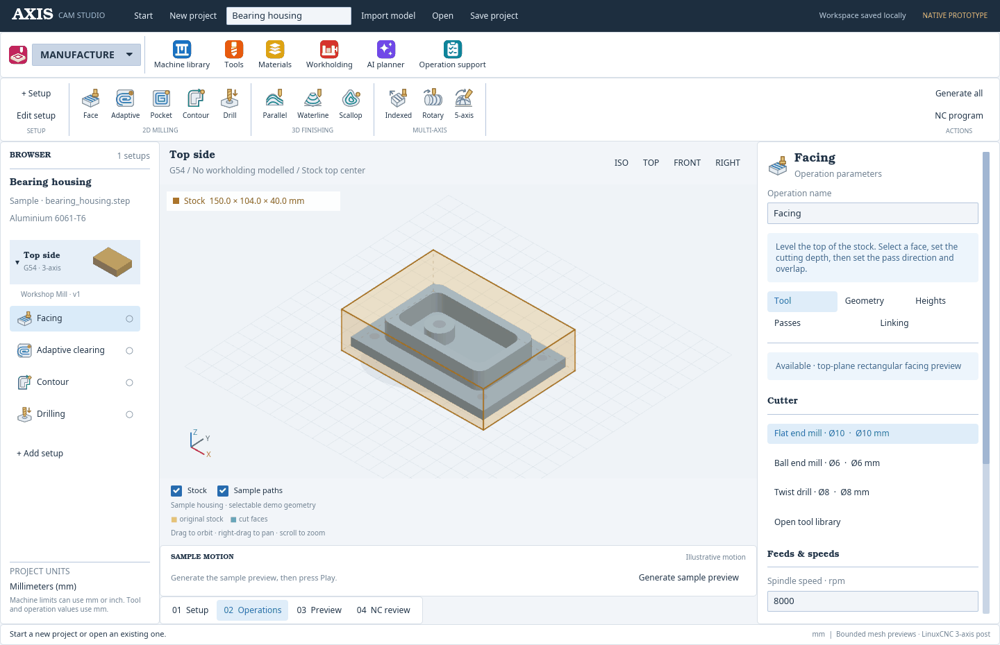

## Run

The app bundle is built from this source with `./scripts/package-macos.sh` (see below). Rebuild it from the current source before opening the workspace: older bundles can drop the material and workholding libraries when they save. A bundle is an Apple Silicon build for macOS 26 or later (the bundled CAD libraries require macOS 26). It includes its STEP reader and runtime libraries; end users do not need Homebrew or Python. Double-click it to open. It is ad-hoc signed, not notarized for public distribution.

To build from source with a current stable Rust toolchain:

```sh
brew install opencascade
cargo run --release --locked
```

The build was tested with Rust 1.97.1 on Apple Silicon. The STEP helper uses a C++17 compiler and Open CASCADE 7.9. The HTTPS client builds aws-lc, which needs a C compiler and CMake. Set `OCCT_PREFIX` to a custom installation prefix if needed. `AXIS_SKIP_STEP=1` explicitly builds without STEP support; the macOS packaging script refuses such a build (`scripts/bundle-step.py` stops with "No compiled STEP helper; package requires Open CASCADE support"). The tests and the renderer smoke run need Open CASCADE too: two STEP import tests and screen 11 of the smoke run fail without it.

| Platform | Status |
| --- | --- |
| macOS | Developed and bundled here (Apple Silicon). |
| Windows | The test suite and the Control page ran as recorded in [docs/VALIDATION.md](docs/VALIDATION.md); there is no bundle script. |
| Linux | The test suite passes on Ubuntu x86_64 with a conda-forge toolchain and Open CASCADE. The renderer smoke needs `WGPU_BACKEND=vulkan`, and its screenshots were unreliable on the one machine tried (issue #90). |

An unset UC100 **Connection** means USB on macOS and Simulated on every other platform (`src/control.rs`).

The build also needs read access to a private repository. `Cargo.toml` pins the `uc100` dependency to a commit of the private GitHub repository [liorknafo/UC100-driver](https://github.com/liorknafo/UC100-driver), and `.cargo/config.toml` sets `git-fetch-with-cli = true`, so cargo fetches it with the `git` command line and uses whatever login that has. Sign in with `gh auth login`, or set up an SSH key that GitHub accepts for that repository (and make `git` use it for `https://github.com/` addresses), before the first build. Without access, `cargo` stops while fetching the driver and nothing compiles, with or without `AXIS_SKIP_STEP=1`. The driver's source is not published with this repository and no licence is stated for it (see `THIRD_PARTY.md`).

Create a macOS bundle:

```sh
./scripts/package-macos.sh
```

The script builds the release binary, bundles the STEP helper with its libraries, the CAD resources, the icon and the license notices, signs the bundle ad hoc in a temporary staging folder and verifies the signature (deep, strict), then writes `dist/AXIS CAM Studio.app`. An optional first argument overrides that output path. Set `AXIS_PACKAGE_ZIP` to an absolute ZIP output path to archive the verified bundle before copying it into a synced folder. It needs Xcode command-line tools and Python 3. `CARGO_TARGET_DIR` can keep build artifacts outside this directory. The icon is the committed `assets/AppIcon.icns`, which the script only copies. `scripts/make-icon.swift` (macOS, `swift scripts/make-icon.swift icon.png`) draws the 1024 px PNG it was made from; the conversion to `.icns` (with `iconutil`) is not scripted.

## What works

| Area | Native implementation |
| --- | --- |
| Start / New project | Blank first launch, explicit example project, resume/open actions, New project shortcut and recoverable project history |
| Workspaces | **MANUFACTURE** (planning) and **MACHINE** (running the CNC), picked like Fusion 360's workspace switcher; only MACHINE while the machine moves (see **Two workspaces**) |
| Workspace | Grouped operation ribbon, custom SVG operation icons, setup/operation browser, parameter inspector, camera views, simulation strip |
| Machine library | Saved profiles; five-step wizard; 3-, 4-, 5-axis configurations; indexed/continuous modes; travel, spindle speed and power, feed, rotary limits, pivots, directions, controller, tool change, TCP preference |
| Multiple setups | Add, duplicate, reorder, delete; independent machine snapshots; G54–G59; automatic remaining stock from earlier setups; origin, fixture, rotation, translation and reclamping instructions |
| Stock sizing | Six independent offsets from placed part bounds; live X/Y/Z dimensions; fixed-size mode; shaded transparent stock with visible/hidden edges and shared part scale |
| Tool library | Editable tool types, diameter, flutes, flute length, stickout and holder diameter; in-use tool deletion protection |
| Material library | Saved materials with group, hardness, notes and cutting data for carbide tools (surface speed and chip load per tooth by tool diameter); fifteen starter materials marked as starting points; a project material picked from the library; warnings when an operation's speed or feed is outside the material's data |
| Workholding library | Saved vises and toe clamps with their sizes (two starters); a setup models a vise or clamps from the library, the app suggests where they go, the 3D view draws them, and every move is checked against them as boxes with a clearance gap; a later setup starts from the stock the earlier setups left, and its holder is checked on that stock (see **Workholding**) |
| Operations | Six implemented imported-mesh preview strategies; explicit status for all eleven strategies; unavailable operations cannot be added to imported jobs |
| Geometry | Imported planar surface selection for Facing, Pocket and Drilling; whole-model Contour/Parallel/Waterline; separate selectable example housing; depth-tested rendering; orbit, pan, zoom and orthographic views |
| STL | Real binary and ASCII mesh preview |
| OBJ | Real mesh preview; polygon fan triangulation and negative face indices |
| STEP / STP | Open CASCADE CAD import and complete tessellated preview, assembly placements, source units converted to mm |
| 3MF | ZIP/XML mesh reader, declared units, build items, nested components, mirrored/placed instances and Production extension external model references |
| Hover help | Descriptions for every app button/input; choice help follows the selected value and related settings; matching native concept animations |
| Planner | One click asks an OpenAI model, on your ChatGPT plan, for setups, operations, tools and cutting parameters; the app checks every proposal with its generators, simulation, export checks and the speeds and feeds against the project material's cutting data, sends failures back for correction, and shows a passing plan for review, apply and undo; while it runs, a timeline lists each step with its time, the size of the reply received and each check's result |
| Simulation | Six imported strategies with cumulative stock across operations/setups, adaptive octree surface meshing, background detail updates, pause/replay/scrub; separate example motion |
| Operation audit | Generate all checks every enabled operation across every setup, reports generated paths and actionable failures, skips suppressed operations |
| Saving | Automatic local workspace saving; explicit JSON project save/open; complete machine, setup, tool, material and operation data |
| Export | LinuxCNC 3-axis `.ngc` per setup (checked and replayed) and a Markdown setup sheet |

### Operation strategies

Facing, adaptive clearing, pocket, contour, drilling, parallel finishing, waterline finishing, scallop finishing, indexed face, rotary finishing and 5-axis surface.

Milling operations use **Tool → Geometry → Heights → Passes → Linking**. Drilling replaces Passes with Cycle. Indexed, rotary and 5-axis strategies add Orientation.

Fields are specific to each strategy: optimal load/rest machining for adaptive clearing; compensation for contours; pecks/dwell for drilling; slopes and surface spacing for finishing; rotary ranges, lead/lean and tilt limits for multi-axis work.

## Operation coverage and checking a whole job

Open **Operation support** in the toolbar for the complete support list. **Generate all / Check all enabled operations** runs validation and actual path generation for each enabled operation in every setup. Failures are collected individually, so one failure does not hide later operations. Reports clear when the document changes. Stock advances in document order across operations and setups. An upstream failure blocks dependent stock previews with an explanation; it never silently substitutes a new blank. Suppressed operations are skipped. The playback timeline remains per operation.

| Strategy | Imported-part status / scope |
| --- | --- |
| Facing | Highest planar face; rectangular raster; flat/face cutter; one-way or zigzag |
| Pocket | Selected recessed planar floor; offset loops preserve islands; flat cutter; plunge/profile ramp |
| Contour | Outside model silhouette or Inside walls/islands of a selected recessed floor; In computer compensation; depth layers and repeat passes |
| Drilling | Circular openings in selected horizontal rim(s), including counterbores; narrowest vertical bore check; drilling, chip breaking, deep peck and bottom-dwell cycles |
| Parallel | Whole-model vertical flat/ball cutter envelope; angled zigzag passes, surface spacing, slope range, vertical stock allowance |
| Waterline | Constant-Z contours around geometry projected above each level; flat cutter, radial allowance and Climb/Conventional |
| Adaptive | Unavailable: engagement-controlled clearing kernel pending |
| Scallop | Unavailable: constant surface-spacing kernel pending |
| Indexed | Unavailable: indexed tool frames / rotary kinematics pending |
| Rotary | Unavailable: continuous rotary paths and stock simulation pending |
| 5-axis | Unavailable: tool-axis planning / machine kinematics pending |

The five unavailable strategies retain their educational illustrations in the explicit example project. Those illustrations are not machining calculations. Existing imported projects containing those operations retain their settings and report a failure when checked.

### Contour, drilling and finishing flow

- **Contour:** choose a flat cutter with adequate reach → Geometry chooses Model silhouette for Outside, or Selected geometry for Inside and a recessed planar floor → Heights references model bottom for Outside or the selected floor for Inside → Passes selects side, Climb/Conventional, stepdown, allowance and repeat passes → Generate. Inside follows only walls/islands rather than clearing the pocket, and offers profile-ramp/plunge entry in Linking. Outside repeats at final depth; Inside repeats at each depth. Arbitrary edge-chain selection and controller compensation are unavailable.
- **Drilling:** choose a drill → select horizontal rim faces containing circular openings → review detected bore/opening diameters, centers and depths; optionally filter by bore diameter (0 includes all) → Heights controls bottom offset and breakthrough, which is added only below holes that go through the part: with Through = Yes a blind hole is refused by name until Through is No or the diameter filter leaves it out → Cycle controls straight/peck/dwell and travel order → Generate. Smaller drills are allowed, so the preview can leave material for a later enlargement operation. Circular opening recognition is tessellation based; the narrowest projected corridor constrains drill diameter. Cycles show cylindrical removal, not a conical drill tip.
- **Parallel:** choose a flat or ball end mill → Geometry uses the whole model silhouette → Heights sets approach and a nonnegative bottom/allowance combination → Passes sets direction, surface spacing, slope range, sampling tolerance and vertical stock to leave → Generate. Cutter envelopes are evaluated against mesh triangle interiors and edges, then sampled on a bounded XY grid. The ball shape is used by stock removal and rendering. This is an approximate finishing preview, not a certified gouge check. Steep transitions and undercuts require additional strategies.
- **Waterline:** choose a flat cutter → whole Model silhouette → Heights sets model-bottom offset → Passes sets stepdown, radial allowance and milling direction → Generate. Projection of all geometry above a level keeps vertical access conservative, so overhung detail may remain unmachined. Ball-cutter waterline and slope filtering are not available.

Separate paths retract to clearance before moving in XY. These four strategies do not expose inactive lead-in or stay-down controls. Inside Contour also supports profile-ramp entry through the shared planar boundary kernel. Spindle RPM and coolant are written to the LinuxCNC program (S with M3 or M4; M8 for Flood, M7 for Mist, the machine's Air output for Air, then M9); the preview does not simulate coolant. A new operation starts with Flood, or on a UC100 machine with what its profile can switch: Mist without a flood output, Off with neither, as on the Jingyan CNC4030 (LIO-145). Feed affects estimated motion time. Every preview inherits earlier enabled cuts, including cuts in earlier setups. Export checks that the holder stays above the stock top and, in a setup that models a vise or clamps, that no move comes within the clearance gap of them (see **Workholding**); other fixture and machine collision solvers remain absent. Depth planning now skips fully cleared top layers using earlier flat-cutter sweeps. General rest machining that isolates leftover islands or corners is still unavailable, and fixtures other than modelled vise jaws and clamps, and the machine body, are not checked; the moves can be exported as LinuxCNC G-code from the NC program page.

Generation limits: 30,000 moves for the new kernels; up to 300 waterline layers; 1,000 contour levels or drill pecks per hole; 500,000 finishing samples and 60 million triangle/sample evaluations. Finishing grid spacing below 0.05 mm is rejected. Polygon offsets include an additional margin of max(0.02 mm, 1% of cutter radius). These limits bound a desktop preview; they do not establish production tolerances.

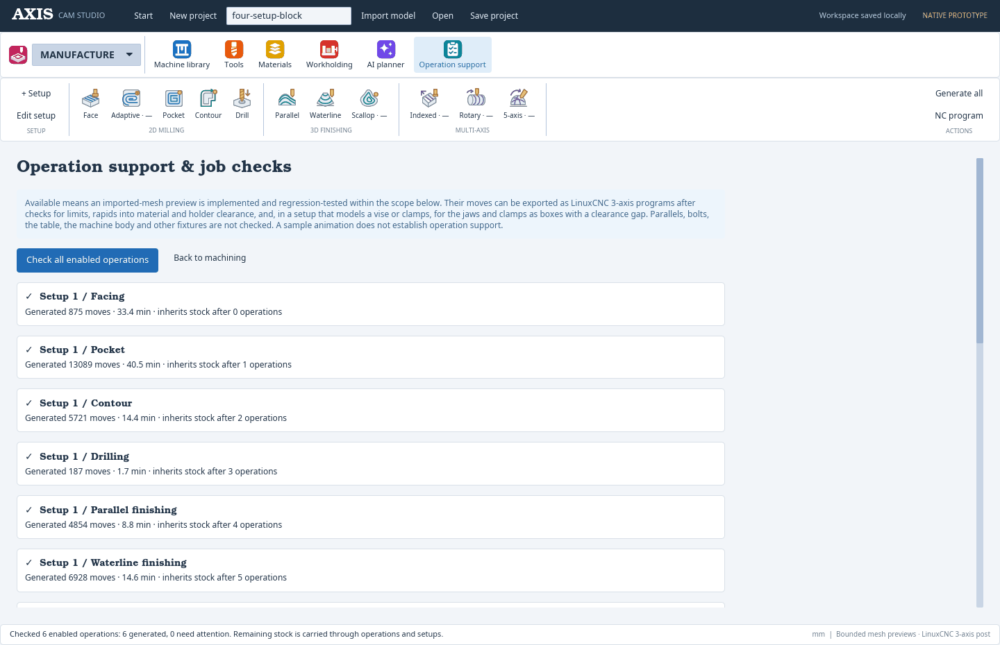

## Contextual help for choices

Hover a choice field to see **the selected option in the title** and its specific behavior. For example, Profile ramp explains a descending contour entry; Plunge explains a straight vertical entry. Changing the choice updates the text and illustration. Milling-method help also reads the saved spindle rotation; Facing explains when Both ways overrides the one-way method preference. Legacy values use the same resolved defaults as the visible control.

Selected-state animations cover spindle rotation, Climb/Conventional, one-way/zigzag facing, keep-down/retract links, ramp/plunge entry, four drilling cycles and cutter containment. Setup, machine, tool-type, coolant, stock mode, playback-speed and display choices also have option-specific text. Saved preferences are distinguished from implemented behavior. These are explanatory animations, not previews of the current job.

The contextual approach references Autodesk's [Fusion Face parameter reference](https://help.autodesk.com/view/fusion360/ENU/?contextId=MFG-REF-2D-FACE-CMD). The native illustrations and descriptions are original and reflect this app's supported behavior. Stock-detail selection uses visible Draft / Standard / Fine buttons so its tooltip cannot obscure a drop-down menu.

Fixture clearance has its own animated side view: a labeled holder, cutter and fixture with a dimension from the nearest tool-assembly edge to the fixture. This setup value only records a requested margin; it does not drive collision checking or toolpath offsets. It is separate from operation clearance height, and from the **Clearance gap** that the check of a modelled vise or clamps uses (see **Workholding**).

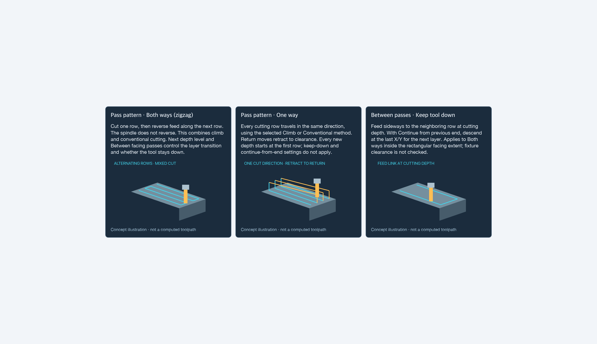

## Cumulative stock and adaptive surface detail

The first setup defines the blank. Every later operation starts with all earlier enabled cuts, in browser order. Later setups reposition that same material: their old nominal stock dimensions do not refill cavities. Editing, suppressing, reordering or removing operations/setups invalidates previews, and generation rebuilds the applicable history. Reordering setups makes the new first setup responsible for the initial blank. An upstream failure prevents dependent previews from presenting misleading fresh stock.

Each setup in the browser has a small picture of the stock as that setup starts: its block for the first setup, and what the earlier setups left for a later one. The active setup's operation list ends with **Stock after this setup**, a picture of the stock as its operations leave it. Both pictures show the stock in the setup's vise jaws or clamps, seen the way the setup's 3D view first shows it, with the original block's faces in tan and cut faces in green.

The pictures are worked out in the background whenever the job changes in the MANUFACTURE workspace, using the run that works out the stock the vise checks use. That run simulates the whole job, and each stock is meshed once at Draft detail. Until it is ready, and after an operation that fails, a setup shows its original block and no picture after its operations. Nothing is worked out on the MACHINE workspace's Control page, so Cycle Start never waits for it.

The same run checks what the whole job leaves unmachined. Each face of the part is sampled 0.5 mm outside itself, in pieces at most 5 mm long. Each sample is tested against the cuts that made the stock the last setup leaves, as those cuts swept it, not against the coarse grid. A face that is at least half under stock is drawn magenta wherever the 3D view shows the part: on the Work page, with the stock hidden or shown as its box, and in the Control page's Job view. Faces with no stock against them from the start count as done. A region under 2 mm² (the sliver a round cutter leaves in a sharp inside corner) is not drawn magenta and is not in the list, though the share of the surface still under stock, given further on, still counts it. The browser's **Still uncut** list gives the regions those faces make where they share edges, largest first. Each line gives its area, which ways its faces face and where it is, in setup 1's axes from the part's −X/−Y/bottom corner. A line under the 3D view gives the share of the part's surface still under stock. Until the run is done, it says **Completeness not checked yet**. With no operation cut yet, or after an operation that cannot be generated, it says **Completeness not checked** and why. A finishing allowance thinner than 0.5 mm counts as cut, and a face the mesh winds inwards reads as under stock.

Each operation of the active setup has a mark in the browser (LIO-143). A green ✓ means the setup will run: it passes the checks a run makes before Cycle Start that do not need the connected machine, which the planner makes too (export's checks, for a machine that is not a UC100). An amber **!** means those checks refuse the setup's jaws or clamps for this operation (its tool or holder comes within the gap of one) or for the whole setup (its clearance plane is not above them, or the workholding cannot be modelled or hold the stock). A grey ✓ means it generated but the setup will not run for another reason, or that its preview is shown and the check is still being worked out. ○ is not generated, — suppressed. The check runs in the background for the active setup, a pause of 0.7 seconds after an edit and whenever another setup is opened, and simulates the job up to the setup's last operation; it does not run on the Control page. Above the playback controls, the simulation panel says what it found for the selected operation's setup, in the Run panel's words, that operation's workholding lines first: "Checking Top as run will…", "Workholding in the way: Run will refuse Top", "Run will refuse Top" (for example for a coolant the UC100 profile has no output for) or "Ready to run: Run's checks of Top pass.". The machine's position and the work zero are checked on the Run panel only. The example's sample paths are never green: they cannot be run.

Cutting start heights also inherit prior work. Facing, Pocket, Contour, drilling pecks and Waterline test whether the volume above their machining envelope is already removed. A completed facing pass can therefore lower the next pocket's start and eliminate redundant depth levels. Positive top offsets and remaining allowances are respected. XY transfers retain the original clearance plane; the vertical approach can descend to the remaining top plus the retract margin. The computed start Z appears in playback and Heights.

This is conservative cap coverage: complete boxes must lie inside earlier constant-height flat-cutter sweeps, using their continuous cylindrical geometry and finite flute length. Coverage subdivides adaptively; any unresolved region or exhausted budget keeps the higher start. The coarse volume grid and display detail cannot cause material to be skipped. Ball/ramp sweeps are not yet used as proof for this optimization; complex transformed or partly cleared regions can retain air passes. A final target-level pass and explicit finishing repeats remain. This does not replace general rest machining with smaller tools.

Stock stores continuous swept cylinders for flat cutters and spherical-bottom sweeps for ball cutters, including finite flute length, vertical entries and sloping feed moves. The geometry stays in the first setup's frame; setup rotations and translations transform cutter coordinates into that frame. Restart and reverse scrubbing restore the inherited geometry before replaying the selected operation. Project files save the job; stock is regenerated when opened.

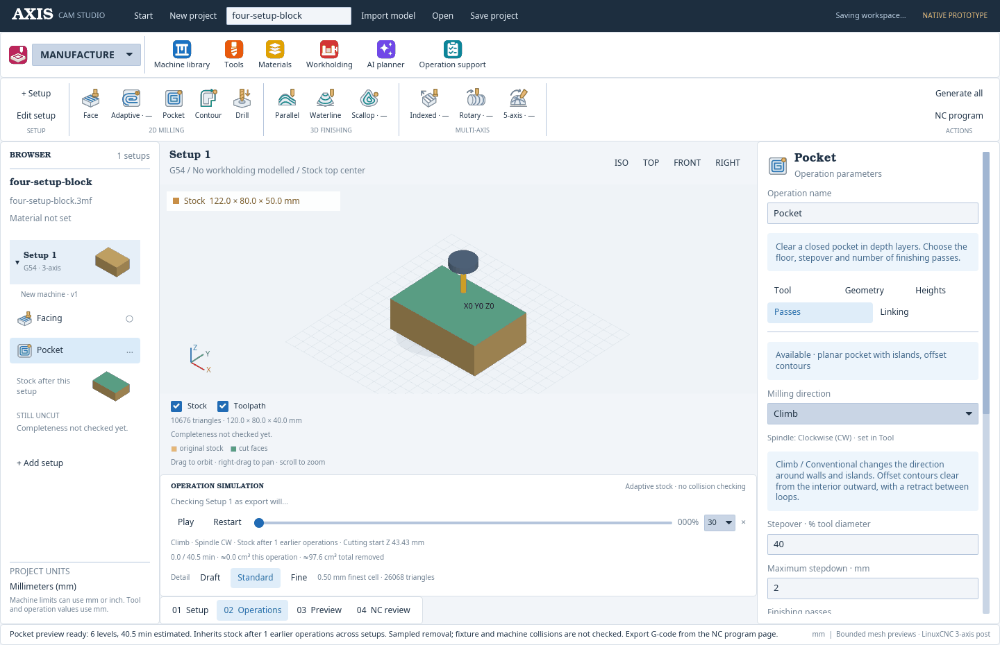

The surface uses [Fidget 0.4.3](https://docs.rs/fidget-mesh/0.4.3/fidget_mesh/)'s adaptive octree and manifold dual contouring. Uniform regions can remain coarse, and boundary cells resolve curved walls, ramps and cutter-radius corners. The visible mesh comes directly from continuous cutter geometry, not smoothing occupied cubes. No dense high-resolution 3D array is allocated. Cutter history uses shared snapshots and combines collinear playback fragments; a bounded coarse occupancy grid remains solely for approximate volume reporting and regression checks.

Choose **Draft**, **Standard** or **Fine** beside the simulation timeline. These use maximum octree depths 7, 8 and 9. The virtual root cube is 104% of the longest stock dimension; a 140 mm blank therefore has finest cell sizes of about 1.14, 0.57 and 0.28 mm. This is a sampling scale, not a dimensional accuracy guarantee. Dual contouring can locate surfaces between sample positions. Features thinner than a cell may be missed, and meshing is not a certified gouge/collision check.

Meshing runs in a background worker. **Updating…** means the last completed stock surface is displayed while a newer snapshot is calculated. Orbit/pan/zoom reuse that mesh. Rewinding discards surfaces from the future; changing detail, selecting a different operation or editing the job rejects stale worker results. Long jobs and Fine detail can take seconds to update; cutter motion is independent of that update. Untouched outer faces stay amber and cut faces are green. Hide Toolpath for an unobstructed view of the stock.

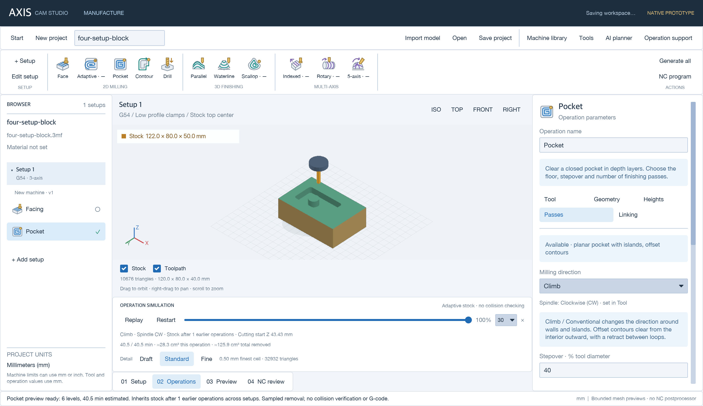

## Start a project from nothing

The app opens on a start screen. Choose **New blank project** to begin with no model, setups or operations and no project material chosen. On a fresh installation the machine library holds the owner's Jingyan CNC4030 (see **Machine control (UC100)**), the tool library is empty, and the material library holds the starter materials (see **Materials**). **New project** in the application bar or **Command/Ctrl+N** starts fresh at any time while retaining saved machine and tool profiles and the material library. The previous job is archived before switching; use **Start → Browse project history** to reopen it, or **Recover previous project** to undo the latest switch during the session.

1. Click **Import your first model** and choose STEP/STP, 3MF, STL or OBJ. The part can be viewed before a setup exists.
2. Choose **Create first setup**. With one saved machine the setup is created with it; with several, choose one in the Machine library; with none, the machine profile wizard opens and its **Save and create first setup** creates the setup.
3. Work through the setup editor's four steps, each a tab under the setup name: **Machine** (the machine, work offset and origin), **Stock** (the project material, chosen from the material library, and the stock offsets or fixed dimensions), **Position** (flips, rotation and translation of the part) and **Holding** (the modelled vise or clamps and the fixture notes). A tab shows ✓ once its step needs nothing more and ○ until then: Machine once the machine profile has no issues, a work offset is chosen and the work zero is on the stock (see **The work zero**), Stock once a material is chosen and the stock box holds the part, Position while every rotation and translation is a number, Holding once a vise or clamps are modelled with nothing wrong. The editor stays on the step last opened, also after opening an operation. New setups contain no operations.
4. Choose an operation and configure its parameters. With no cutter yet, the operation opens the Tool library; its **Save and continue to** button (for example **Save and continue to Facing**), which sits under the form and stays in sight while its fields scroll, saves the cutter and adds the operation (LIO-147).

An action that needs something you have not made yet sends you to make it and then finishes once it is saved. Leaving that page instead drops the action.
5. Add further setups for each repositioning of the part. The last setup can be deleted, returning the project to a part with no setups.
6. Use **Save project** to create a portable `.axis.json` file, and **Open** to restore it later.

"Setup" means one thing: a **setup** is one position of the part on the machine, with its stock, work zero and holding. The reusable description of a machine is its **machine profile**, made in the Machine library with **New machine profile** (the machine profile wizard), and the UC100's profile form, pin tests, calibration and commissioning are **Controller configuration** in the MACHINE toolbar.

### The work zero (LIO-166)

The setup editor's **Machine** step chooses the setup's **Work coordinate origin**, the point its program and its runs are cut from: a corner, the middle of an edge or the centre of the stock's top or bottom ("Stock top center", "Stock top front-left", "Stock top back", "Stock bottom front-right" and so on: front is −Y, left is −X), or **Model origin**, the part file's own 0,0,0. A stock-based zero is a point of the box the setup starts from: setup 1's stock, and for a later setup the stock the earlier setups leave (see **The stock earlier setups leave**), in that setup's frame, so a flipped or turned setup has its own top, bottom, front and left. The editor says under the choice where it is touched off on that stock, and which probing routine on the Control page finds it.

Every zero is found from the stock top and the sides it names: a corner from the top and the two sides at it, the middle of an edge from the top, the side at it and both sides across, the centre from the top and all four. A zero on the bottom is touched off on the top too, as the stock's height above the bottom: the bottom sits on the workholding. Model origin is found from the stock top's front-left corner and set off from it as the program has it. Each side is touched in a band 1 mm to 10 mm below the top (less on low stock), near the end nearer the zero (5–15 % of its length from it) or near its middle; the top over the zero (within 10 mm of a corner, at least 1 mm in from both edges). The program header, the help card, the Run panel's steps and the Control page's probe all name the same spots.

The zero must be on material that is there. Once the background check of the active setup is back, the editor lists under the choice, in the words Run and export refuse it with:

- **The work zero is not on the stock** when earlier setups have cut a spot it is touched off on, or the stock under a zero on the bottom, or when the stock is not square to the setup. The message names the spot and the work zeros still on the stock ("Later: earlier setups have cut the stock's top face at its centre, so the Stock top center work zero is no longer on the stock. Choose one that is, Stock top front-left, …, or Model origin for this setup."). Export and Run refuse the setup, and the Machine step keeps its ○.
- **No probe finds this work zero** when a vise jaw or clamp stands where the probe would go down beside a side or onto the top's spot (the column out to 10 mm from the side, up to 10 mm above the top), or when the stock-top corner Model origin is found from was cut. The setup can still run: touch the zero off by hand.

The same point is used everywhere: the program's coordinates (plan point − work zero), the simulation and a run's moves (plan point − work zero + the machine's work offset), the 3D view's **X0 Y0 Z0** marker (drawn on the stock the simulation starts from, or the box the editor knows for the setup), the header's touch-off words, the Run panel's steps and the probe.

Six operations generate imported-part motion and approximate stock removal within the scopes below. Production toolpaths, collision checks beyond the vise jaws and clamps a setup models (see **Workholding**) and the five explicitly unavailable strategies remain future work. To try the illustrative paths, choose **Start → Explore example project** explicitly.

## Try the example workflow

Open **Start → Explore example project** first. This loads the housing, sample library entries and example operations. Your saved tools and machine profiles stay in the library without duplicates: a sample tool that matches one of yours apart from its number takes your number, your other tools keep theirs, a sample tool whose number is then taken gets the lowest free one, and the status bar names the tools and machines added from your library, and the materials of yours that are not starters. Your materials are kept the same way, matched to the example's by name (capitals ignored): the example's material is linked to yours, or, when you deleted it, added without cutting data, and the status bar says which.

1. Open **Machine library → New machine profile**, complete the wizard and save. Assign the profile to the current setup.
2. Click **Edit setup** and go through its **Machine**, **Stock**, **Position** and **Holding** steps to configure the work offset, origin, material, stock, part position and workholding.
3. Choose an operation from the ribbon. Set the cutter and feeds/speeds; a warning on the Tool tab shows when they are outside the project material's cutting data (see **Materials**).
4. Open **Geometry**. Select sample features from the list or click them in the viewport. Drag still orbits the model.
5. Set Heights, Passes/Cycle, Orientation when applicable, and Linking.
6. Click **Generate sample preview**, then **Play**. Previews are invalidated when job parameters change.
7. Duplicate a setup, use **Flip X 180°** or enter any rotation/translation, select its stock source and add reclamping instructions. Repositioned setups are saved and visualized; their toolpath calculation remains pending.
8. The AI planner works on imported parts, not on this example (see **Plan a job with AI**).
9. Open **NC program** to review configuration issues and export the setup sheet. G-code export is refused for the example project; it is for imported parts (see **LinuxCNC G-code export**).
10. **Save project** writes a portable `.axis.json` file. **Open** restores it.

Viewport: left-drag orbits, right/middle-drag pans, scroll zooms; ISO/TOP/FRONT/RIGHT reset the camera: TOP shows +X to the right and +Y up, FRONT, from −Y, +X to the right and +Z up, and RIGHT, from +X, +Y to the right, and dragging turns the model the way the mouse goes. Command/Ctrl+N starts a blank project, Command/Ctrl+S saves a project and Command/Ctrl+O opens one. In a form, Tab moves to the next field and Shift+Tab to the previous one, for example through the stock offsets; the field's value arrives selected, so typing replaces it.

The fit scale stays constant while orbiting and panning. Full-resolution viewport frames are uploaded as small tiles with filtering gutters, keeping them below Iced 0.14's asynchronous image-upload threshold and preventing missing model frames during camera movement.

Imported geometry supports **preview, stock sizing, planar surface selection and the six operation previews listed below**. The viewport always shows the current project’s part. Example geometry and illustrative paths are available only through the separate example project. STEP and 3MF dimensions are reported in mm; STL and OBJ have no reliable declared unit and are reported in source units. Stock sizing treats STL/OBJ coordinates as mm, with an explicit note beside the fields. The display centers the mesh and fits the part and stock together; both use the same scale. Exact CAD-to-machine origin placement remains pending. Stock and operation settings use mm; machine specifications can use mm or inches.

### Facing on an imported part

1. Add **Facing**, choose a saved tool and open **Geometry**.
2. Click a planar region on the actual part in the viewport. Amber shows the hovered region; blue shows selected regions. Click again to remove it. Drag to orbit, or use TOP to look down setup Z.
3. Click **Finish picking**. The selection remains highlighted and is saved per operation. Use the selected-surface list or **Clear surface selection** to remove selections.
4. Configure Heights, Passes and Linking, then **Generate operation preview** or **Generate & play** below the viewport. Checks flag surfaces that are not perpendicular to setup Z (0.5° tolerance) or lie on different planes (0.001 mm height tolerance). Reposition the part in another setup to face a side, or use separate operations for different heights.

Selections are connected coplanar triangle patches, not exact CAD faces. Curved surfaces remain faceted. Winding is not treated as proof of machining access; collision with anything but modelled vise jaws and clamps, reachability and production toolpath computation are still pending. Selecting a surface alone does not generate a preview; generate it or use Generate & play.

Saved selections contain a SHA-256 fingerprint of the imported tessellation and its triangle order. Reopening the same geometry restores them; changed tessellation is reported and must be reselected. Importing a replacement part clears prior geometry selections while keeping operation parameters. Legacy imported projects’ sample-only selections are cleared on restore. Whole-model strategies use the imported silhouette. Unavailable strategies display an explicit status and cannot be added to imported jobs.

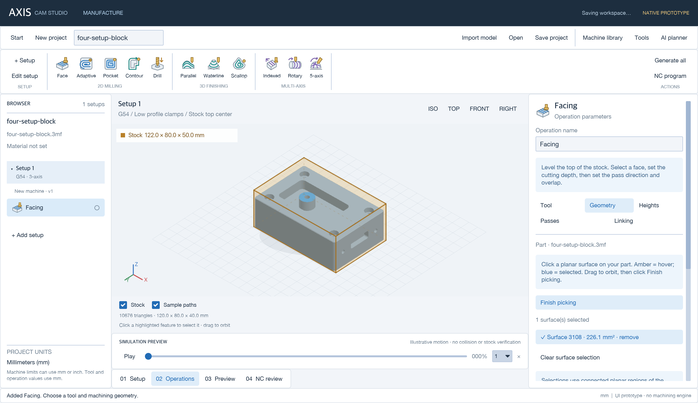

### Imported Facing simulation

Select a saved Facing operation with valid geometry, stock and a flat end mill or face mill. Click **Generate & play** below the viewport to generate and start. **Generate operation preview** in the inspector prepares the preview without starting it. Use **Pause**, **Restart**, **Replay**, the timeline and **1× / 10× / 30× / 60× / 120×** speed. The default for a generated Facing preview is 30×. Reopening a project requires regenerating its preview.

- The preview computes alternating straight passes from the tool diameter, stepover, maximum stepdown, pass direction, selected plane, top/bottom offsets and radial allowance. It uses the **XY bounding rectangle** of the selected surfaces, model or stock, including holes and gaps within that rectangle. Tool containment adjusts cutter-center limits against that rectangle.
- Before considering earlier cuts, the starting plane is the higher of stock top or selected plane + top offset. Proven prior removal can lower the cutting start. Bottom offset sets the target relative to the selected plane. The preview refuses a target below the highest point of the placed model. It supports repositioned setups whose selected face is now the highest plane, while retaining material removed in earlier setups.
- **Passes → Pass pattern** selects **Both ways (zigzag)** or **One way**. Both ways reverses each adjacent cutting row. **Next depth level → Continue from previous end** reverses the complete row sequence at each depth so the first stroke begins at the preceding endpoint; **Return to first start** repeats the layer from its original XY.
- **Tool → Spindle rotation** selects **Clockwise (CW)** or **Counterclockwise (CCW)**, viewed from the spindle toward the part along setup −Z. Match the cutter's cutting hand. **Passes → One way → Milling direction** selects **Climb** or **Conventional**, relative to the nominal uncut side of each row. Changing spindle rotation reverses one-way cutting strokes for the same method. Both ways is explicitly **mixed climb/conventional**; the spindle does not reverse between rows. Entry and full-width engagement may contain both modes even in one-way paths. Animated hover illustrations compare cutter feed with a fixed CW spindle. The simulation identifies its method and rotation; it does not animate actual RPM. Spindle commands are written only to the exported G-code.
- New operations default to CW and a Climb preference for One way. Missing rotation/method settings in older one-way jobs resolve to CW/Conventional to preserve their existing motion; their path does not silently reverse. Both settings are saved with the operation and invalidate its preview when edited.
- **Linking → Between facing passes → Keep tool down** feeds between neighboring rows at cutting depth. With Continue from previous end it feeds vertically down at the last endpoint and cuts the next layer in reverse. **Retract each pass** lifts to clearance between rows. One way always retracts for its returns and repeats each depth from the first row. The new presets default to Both ways, Continue from previous end and Keep tool down; older saved operations retain Both ways, Return to first start and Retract each pass until changed.
- Initial entry and retracted links traverse at clearance, approach the retract plane, then plunge. Cutting uses the specified feed, plunging uses 25% feed and rapids assume 6,000 mm/min. Timing omits acceleration, spindle ramp-up, tool changes and controller behavior. Lead-in curves and fixture avoidance are not implemented. Keep-down links follow straight lines inside the convex rectangular cutter-center boundary; the preview itself performs no collision checking (the warning for modelled vise jaws and clamps is separate: see **Workholding**).
- Continuous flat/ball cutter sweeps subtract material from the initial stock. An adaptive octree and dual contouring produce the visible surface. Amber marks original exterior faces; green marks cut surfaces. Rewinding reconstructs the earlier state; Restart restores the stock left by preceding operations and setups. The volume readout is a separate coarse estimate.
- With Stock enabled, the viewport shows the remaining blank, so unmachined pockets remain filled. Hide Stock to see the reference model. Toolpath displays the latest cutting pass and active rapid. The cutter uses saved diameter, flute length and stickout; the holder uses its saved diameter with an illustrative 8 mm collar length.
- Edits to geometry, tools, stock and operation parameters invalidate the preview. Unsupported operations show an unavailable state instead of inert playback controls. Executable LinuxCNC output is on the **NC program** page (see **LinuxCNC G-code export**), and the AI planner checks for gouges only along the tool's centre line and coarsely on the stock grid (see **Planner checks without AI**). A single combined-program timeline, full collision/gouge verification and simultaneous multi-axis simulation are not implemented. The top-plane guard is a limited geometric check, not a manufacturability check.

Generation is bounded to 2,000 cutting strokes. Very small step sizes, unsupported tools, no stock above the target, stale selections, unsuitable planes and unsupported stock sources show a specific explanation.

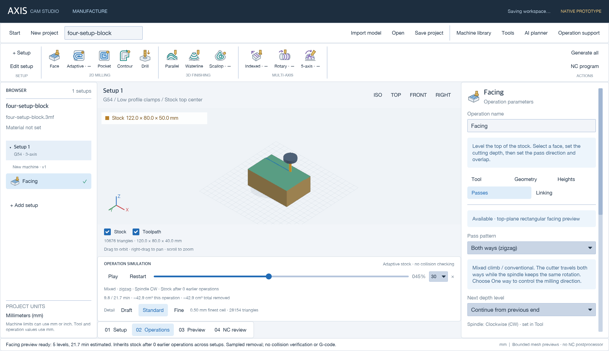

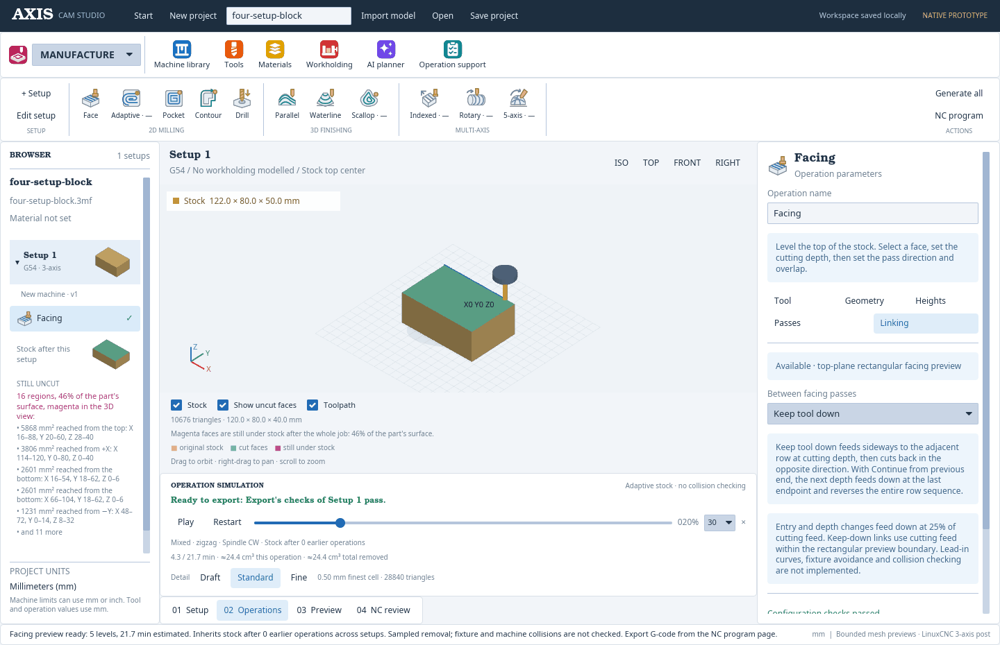

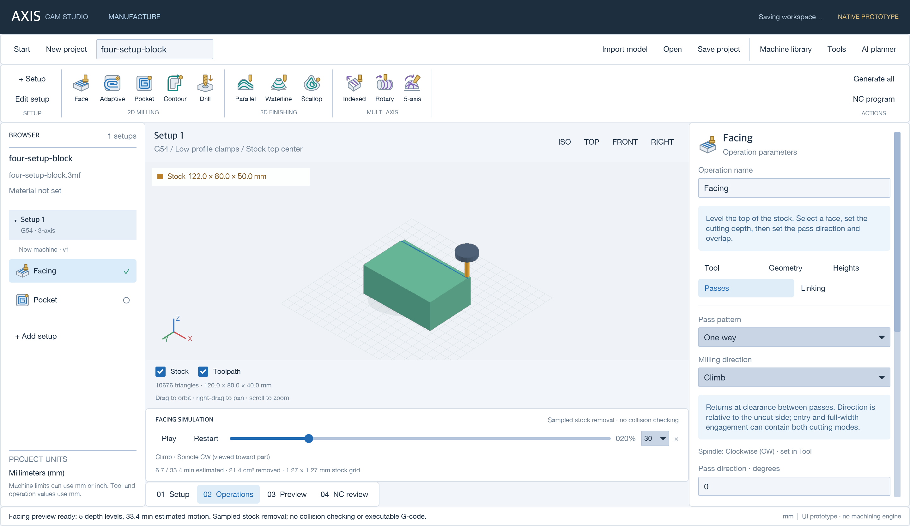

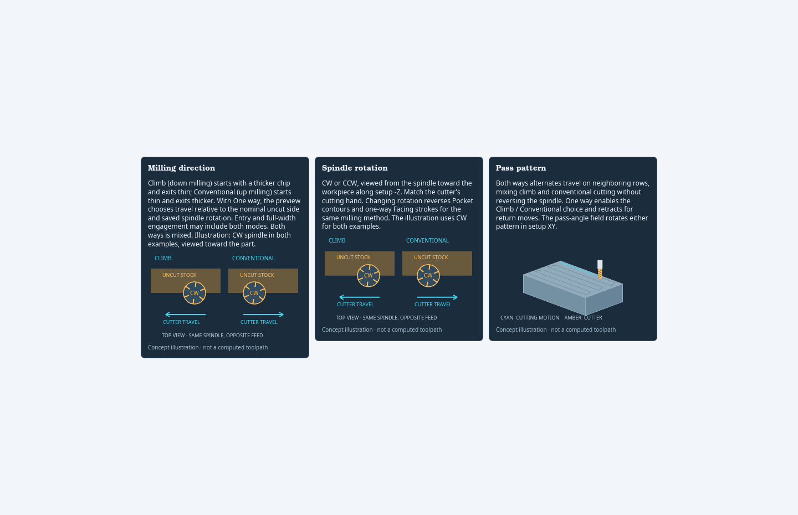

### Pocket on an imported part

1. Add **Pocket**, choose a saved flat end mill and set **Tool → Spindle rotation** (CW/CCW, viewed toward the part).
2. In **Geometry**, click the recessed planar floor and **Finish picking**. Multiple coplanar regions can be selected. Their triangle union supplies the actual XY boundary; holes remain islands. Pocket uses **Selected geometry / Tool inside boundary**, rather than a rectangular Facing extent.
3. In **Passes**, choose **Milling direction → Climb or Conventional**, stepover (up to 50%), maximum stepdown, radial/axial stock to leave and optional repeated finishing loops. The milling direction is always visible. With CW, climb travels CCW around the internal wall and CW around islands; reversing spindle rotation reverses these paths.
4. In **Linking**, choose **Profile ramp** (0.1°–15°) or **Plunge**. A profile ramp descends along the current contour at 25% feed, then completes it at depth. Plunge requires a plunge-capable cutter. All contour transfers retract to clearance; links do not cross islands at depth.
5. Click **Generate operation preview** or **Generate & play**. Pause, replay and scrub work with the same remaining-stock model as Facing. Pocket paths on the current depth layer remain visible. Direction/rotation/geometry/tool edits invalidate the preview.

The planner offsets the selected floor inward from the cutter radius and radial allowance, then traverses the contours from inside outward at each depth. Holes/islands and disjoint regions are retained by polygon union/offset operations using [Clipper2](https://docs.rs/clipper2/0.6.0/clipper2/). A conservative geometry margin of max(0.02 mm, 1% of cutter radius) covers integer rounding and arc approximation. Narrow areas/corners that cannot admit the cutter remain uncut. Finishing loops repeat the boundary at the selected allowance; they do not automatically remove that allowance.

Bottom offset plus axial allowance is measured from the selected floor and cannot place the target below it. Start is stock top plus a positive Top offset. Maximum stepdown is limited by flute length, and full depth must be less than stickout. The selected floor must be horizontal and recessed; projected geometry above it is checked for obstructed vertical access. Sloped/overhanging floors, incompatible cutters, stale selections and excessive plans are rejected with an explanation. Bounds: 256 offset rings and 30,000 motion segments.

**Pocket starts from the stock left by preceding enabled operations and setups.** The continuous 3D stock retains cavities when the part is flipped. Each operation has its own timeline; Restart restores its inherited starting stock. The vertical-access check is not a tool/holder/fixture collision solver. This is an imported-part preview, not production NC output.


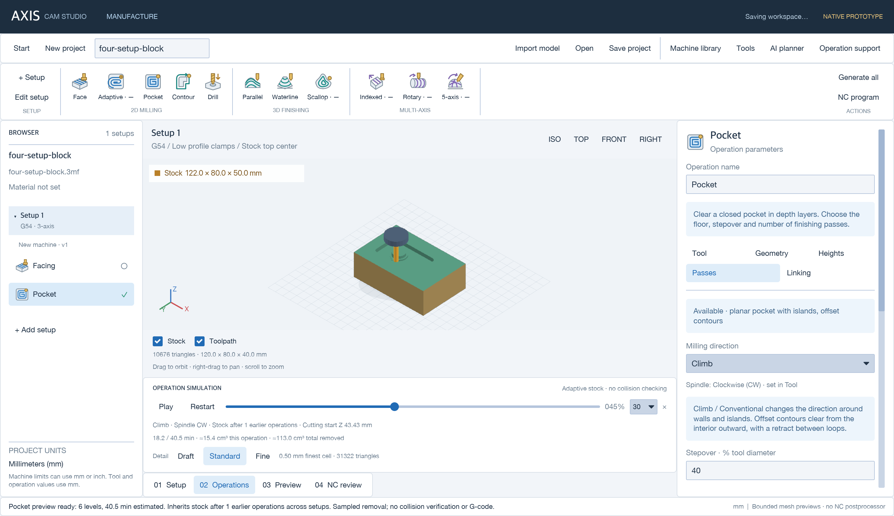

### Relative and fixed stock

**Relative size box** measures extra material from each side of the part's bounding box after the setup's rotation:

| Axis | Negative side | Positive side | Resulting dimension |
| --- | --- | --- | --- |
| X | Left | Right | Part width + left + right |
| Y | Front | Back | Part depth + front + back |
| Z | Bottom | Top | Part height + bottom + top |

Each offset is independent, in mm; zero is flush with the part. For a 120 × 80 × 40 mm part, top = 10, right = 2 and all other offsets = 0 gives **122 × 80 × 50 mm stock**. Sides follow setup axes, not the camera. Relative stock follows part translation; rotation recalculates the part bounds. The read-only result, viewport and setup sheet all use the same calculation. Bounds come from the preview mesh, including the STEP tessellation, rather than exact CAD surface extrema.

**Fixed size box** uses explicit X/Y/Z dimensions and stays centered on X/Y with its bottom at the display Z=0 plane. Switching modes retains each mode's inputs. Invalid offsets, missing geometry or invalid dimensions display an explanation and suppress the stock box instead of using fallback dimensions.

Stock is rendered as a lightly shaded transparent amber box. Solid visible edges and faint dashed hidden edges distinguish the stock from the blue-gray part. Each offset field includes a looping illustration of extra material on that side.

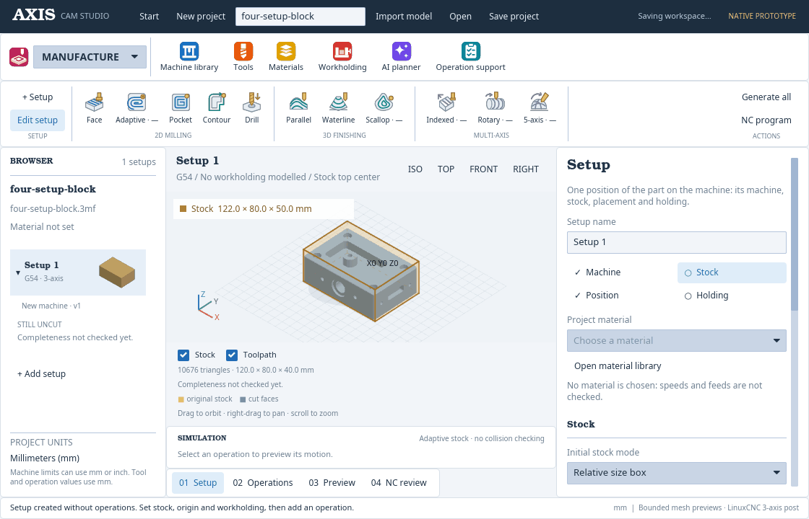

Older saved projects whose relative mode contained only overall dimensions reopen as **Fixed size box**, preserving those dimensions. Select Relative size box to use the new per-side offsets. Later setups start from the material left by earlier enabled operations and setups, including after flips.

**STEP:** Open CASCADE reads surfaces/solids and assemblies; the helper tessellates at 0.05 mm linear deflection and 0.3 rad angular deflection. Assembly placements and unit conversion are applied. The original file stays intact. Exact CAD topology, colors, PMI and automatic machining feature recognition are not exposed to the app yet. Facing and Pocket selection use connected planar regions of the tessellated mesh. Wire-only models, failed translations, or faces that cannot be tessellated are rejected with a readable error. Conversion runs outside the GUI and times out after two minutes.

**3MF:** Uses the package root relationship, not an assumed filename. Only printable root build items are displayed, with referenced components, nested transforms and winding correction for reflections. Geometry-only support excludes material/color/texture and printer-specific settings, boolean union of overlapping parts, and non-mesh extensions. Unknown required extensions and mixed units across external model parts are rejected rather than guessed. Production geometry references are supported; this is not a complete 3MF conformance implementation. Percent-encoded package URIs are currently unsupported.

Limits: 50 MB source file, 100 MB expanded 3MF XML, 200,000 displayed triangles, 4,096 archive entries, 128 model parts and 64 levels of component nesting. Large meshes are rejected rather than previewed with missing triangles. OBJ fan triangulation assumes convex polygon faces. Saved imports reopen in the background; a missing or invalid original file is reported explicitly.

### Tooltips and animated help

Hold the pointer over a button, field label/input, dropdown or toggle for about **0.6 seconds**. Command cards explain the action; field cards explain meaning, units and practical consequences. Relevant cards show a five-second looping native canvas illustration: facing, pocket clearing, drilling, finishing, rotary/indexed motion, tool tilt, clearance planes, pass spacing, layer depth or cutter dimensions. No GIF download or network connection is needed. Illustrations explain concepts; they are not computed toolpaths and do not depend on the current parameter value. Animation updates run at approximately 30 fps while an animated help target is hovered.

A click puts the help away (LIO-148). Pressing a button, tab, field or other control shuts its card, and the card stays shut until the pointer leaves that control and comes back, so it never covers the page or result the click opened. A control that a click brings up under the resting pointer shows no help until the pointer moves off it and back.

## Materials

The **Materials** page (in the toolbar, beside Tools) is the material library, built like the tool library: a list (name, group, surface speed range), an editor, **+ New material**, **Save material** and **Delete material**. Every field has hover help that explains surface speed (Vc) and chip load per tooth (fz).

- **A material** has a name (at most 60 characters; unique in the library, capitals and spaces at the ends ignored), a group (Aluminium, Steel, Stainless steel, Brass and copper, Plastic, Wood and composite, Other), hardness and notes (free text; notes up to 500 characters) and **cutting data for carbide tools**: a surface speed range in m/min and a chip load range per tooth in mm for each of five tool diameters (up to 3 mm, over 3 up to 6, over 6 up to 10, over 10 up to 16, over 16). Cutting data is all twelve numbers or none: each positive and each minimum not above its maximum. A material without cutting data can be chosen, but nothing is checked against it and the AI planner will not plan with it. Delete is refused while the project uses the material.
- **Starter materials**, each marked in its notes "Starting point for carbide tools: adjust to your machine and your tool maker's data.": Aluminium 6061-T6, Aluminium 7075-T6, Mild steel 1018, Stainless steel 304, Brass C360, POM (Delrin), Acrylic (PMMA), HDPE, MDF, Aluminium 6082-T6, Aluminium 6063-T6, Aluminium 5083-H111, Aluminium 5052-H32, Aluminium 1050A-H14 and Cast aluminium plate (MIC-6). They are conservative starting points, not your tool maker's data: edit them to suit your machine and tools. They are added only to an empty library (a new workspace, a project or workspace saved before the library existed, a new project, Explore example), so a material you deleted does not come back while the library has any entry; a library you emptied gets the starters again the next time a project is opened or started. A library saved before these six were added gets them once, unless it already has a material of that name (capitals ignored); deleting one afterwards is final.
- **Older projects** kept the material as text. When one is opened (project file, workspace at start-up or Recover previous project), a text that matches a library material's name (capitals, also those outside ASCII, and spaces at the ends ignored) is linked to it. Otherwise a material with that name, group Other and no cutting data is added to the library and chosen. The status bar says which: "The project material "X" was linked to the library." or "… was added to the material library without cutting data; add it on the Materials page." `--export-gcode` says the same after its result. A note shows a name cut to one line of 60 characters. A workspace that start-up changed like this (this, or tools numbered) is saved once, so the note does not come back at the next start and a material added without cutting data keeps its identifier.
- **The project material** is chosen in the setup editor's **Stock** step from a picker of library materials, with **Open material library** beside it. The project saves the chosen material's id and keeps its name as the project's material text, which the setup sheet still prints. A note under the picker says when the chosen material has no cutting data, or when none is chosen: speeds and feeds are then not checked. New project keeps the library, and Explore example merges it without duplicates.

### Speed and feed check

For an operation whose tool has diameter D (mm) and z flutes, with spindle speed n (rpm) and cutting feed F (mm/min), the app computes the surface speed Vc = π × D × n ÷ 1000 (m/min) and the chip load per tooth fz = F ÷ (n × z) (mm). The chip load range is the one for D's diameter band. The operation is **in range** when Vc is not above the material's maximum and fz is not above the band's maximum, and neither is below its minimum, with two exceptions for what a machine cannot do: a Vc below the minimum is accepted when n is the machine's maximum rpm (a small tool cannot reach the minimum surface speed), and an fz below the minimum is accepted when F is the machine's maximum feed (an inch machine's feed limit is converted to mm/min). A value above a maximum is never excused. Every limit has 1% of slack for rounding. Plunge and ramp feeds are not checked.

- **Not checked, with the reason shown:** a material without cutting data, a tool without diameter or flutes, an operation without a spindle speed or feed (or with a zero one), and an operation whose tool is not in the library. Without a chosen material nothing is checked and no line is shown.
- **Ball end mills** are checked with the nominal diameter. A ball end mill cutting shallow engages less than its nominal diameter, so its real surface speed there is lower than the computed one: the check can flag a speed that is fine at shallow depth, and it cannot see that a speed is too low for a shallow ball cut.
- **Drills** are checked like end mills: fz = F ÷ (n × z) with the drill's flutes, against the same chip load ranges. This is a rough guide only. A drill's feed is usually given per revolution, and the library has no drill-specific ranges, so a drill feed that is fine can be flagged, or refused in a plan.
- **Your own operations get warnings.** The Tool tab of the operation editor shows an amber box, "Speed or feed outside the material's cutting data", with each value and the material's range (for chip load, the range for the tool's diameter), for example "Surface speed 452 m/min is above Aluminium 6061-T6's 150–300 m/min.", or a line "Not checked." with the reason. The NC program page lists the same lines for every enabled operation, headed "Speeds and feeds outside the material's cutting data (export still allowed)", or "Speeds and feeds not checked (export still allowed)" when it only lists operations that could not be checked. Warnings never block an export.
- **The AI planner is refused plans outside the data.** The part report sent to the model carries the material and its cutting data, the instructions explain the two formulas, the bands and the machine-limit exceptions, and a plan with an operation outside the data, or one whose speed and feed cannot be checked (no material, a material without cutting data, a tool or an operation without the numbers), fails the check, with the value, the range and the setup and operation named, and goes back to the model for correction like any other problem (see **Planner checks without AI**).

The cutting data are starting points for carbide tools, with no distinction between coated, uncoated or HSS tools. Being inside them says nothing about cutting loads, tool deflection, chatter, fixtures or the machine.

## Workholding

A setup can model the vise or the toe clamps that hold its stock. The app then checks every move against them, as boxes, and refuses a program that would hit one. Toolpaths are never changed to avoid them: a move that comes too close is reported, not rerouted.

- **The library.** The **Workholding** page (in the toolbar, beside Materials) lists vises and toe clamps, built like the tool library: **+ New vise**, **+ New clamp**, **Save** and **Delete**. A vise has a jaw width (along the jaws), a jaw height (for reference: the modelled jaws reach from far below the stock up to the setup's grip), a jaw thickness, a maximum opening and a grip (the default height of stock held between the jaws, from the stock's bottom). A clamp has a length (along the clamp, from its tip outward), a width, a height above the stock's top and a bite (how far it reaches onto the stock from its edge; it must be shorter than the length). Each has a **Clamping force** in newtons, how hard the vise clamps or one clamp holds the stock down, for the force check (see **Does it hold against the cut?**); it may be left empty, which takes 5000 N for a vise and 2000 N for a clamp. Every size is a positive number, a name is unique in the library (capitals and spaces at the ends are ignored) and at most 60 characters, and notes are up to 500. A library that has none gets two starters, marked "Measure yours: these are typical sizes.": "100 mm machine vise" (jaws 100 mm wide, 30 mm high and 20 mm thick, opening 120 mm, grip 8 mm, clamping force 5000 N) and "Toe clamp 60 mm" (60 mm long, 20 mm wide, 25 mm high, bite 12 mm, clamping force 2000 N). An entry that a setup uses cannot be deleted. The library is carried to a new project, and Explore example adds yours to the example by name, as it does for tools.
- **The setup controls.** The setup editor's **Holding** step has **Modelled workholding**: None, Vise or Clamps. With a vise you pick the library entry, **Jaws face** the X sides or the Y sides of the stock, a **Jaw offset** along the jaws from the middle of the stock and the **Grip**. With clamps you pick the entry and set **Clamp positions** a row per clamp: its side (-X, +X, -Y or +Y) and an offset in mm that moves it along that side from its middle. **Remove** takes a clamp off (one always stays) and **+ Add clamp** adds one at the middle of the next side, up to eight. The positions are saved once every offset is a number, what is wrong is shown under the rows, and the setup keeps them as `side:offset` separated by semicolons (`-X:0;+X:20`). **Clearance gap** is the margin kept round every jaw and clamp (0 or more; 2 mm when empty). What is wrong is listed under the controls: no entry chosen or the entry deleted, a layout that does not read, an entry of the other kind or with sizes that cannot be used, a stock wider across the jaws than the vise opens, jaws that do not overlap the stock along their length (an offset of half the stock's length plus half the jaw width or more), a clamp whose offset is beyond half the length of its side, and a later setup that is not square to setup 1 (turned from it by other than a multiple of 90 degrees), whose vise or clamps cannot be modelled: choose None there, or square the setup. **Fixture clearance** remains as a record and is not checked. The modelled workholding is what says how a setup is held (LIO-144). The setup's header names it ("G54 / 100 mm machine vise / Stock top center", "4 × Toe clamp 60 mm"). With None, a **Fixture note · not checked** (None, Low profile clamps, Vise, Soft jaws, Chuck or Custom fixture) records what holds the stock: the header shows it as "Chuck, not modelled", or "No workholding modelled" without one, and the setup sheet and the program header print it as `Fixture:`. Once a vise or clamps are modelled the note is hidden and printed nowhere, so the two never disagree. A new setup has no note.
- **Where the boxes are.** All in the setup's own frame, from the setup's starting stock box. A vise has two jaws against the two chosen sides of what it closes on (the stock, or in a later setup the band within its grip: see **What the vise closes on**), each a jaw thickness deep outward and a jaw width long, centred on that plus the offset, from 100 mm below the stock's bottom up to the grip above the bottom the stock stands on (the box's bottom; in a later setup the highest its material's bottom can lie: see **The stock earlier setups leave**). A clamp is a box a clamp width wide, centred at its offset along its side, reaching the bite inward from the stock's edge and the rest of its length outward, from the stock's top up by the clamp's height. In a later setup they sit at the box that setup starts from: the stock the earlier setups left (see **The stock earlier setups leave**), or setup 1's box carried over into that setup's frame while that has not been worked out (see **The setup editor**); a vise turns with the stock and a box does not, so a later setup that is not square to setup 1 has no modelled workholding and is refused. The 3D view draws them as grey boxes with the stock (the jaws from the stock's bottom up; the check keeps them whole), and the setup sheet describes them ("Workholding: 100 mm machine vise on ±Y, grip 8 mm, offset 0 mm, gap 2 mm."; "Workholding: 4 × Toe clamp 60 mm at -X 0, +X 0, -Y 0, +Y 0, gap 2 mm."), as the program header does in plain ASCII ("on +-Y", "4 x").
- **Suggest layout.** Choosing Vise or Clamps for a setup that has no placement of that kind yet, choosing another library entry, and **Suggest layout** generate the setup's operations (up to its last enabled one, as Generate all does; those that cannot be generated are left out) and place the workholding where their toolpaths stay clear of it, without changing them. A vise goes at offset 0 on the X or the Y sides, whichever are clear of every move at the largest grip: each axis is tried at the library's grip and then 1 mm lower at a time down to 3 mm, and the axis that is clear at the larger grip wins; when both are clear at the same grip, the sides with the narrower width across the jaws; when neither is clear even at 3 mm, the sides whose jaws stay farther from the moves, at 3 mm. When only one axis fits the vise's opening (across the band the jaws would close on, in a later setup), only that one is tried. Clamps are four, one on each side, or two on opposite sides when the stock is shorter than three clamp widths along both axes; each is placed at the middle or the quarter point of its side that keeps its distance largest, a spot that is clear by 10 mm or more counting as good as any, so the middle wins then. The status line says what was chosen and how many operations still come within the gap ("see the warnings"); with no toolpaths to look at, it says only the stock decided. Anything you set by hand is kept by other edits until you press **Suggest layout** again. The suggestion looks at each operation's own toolpath: the links between operations, the approaches and the retracts that export adds are not part of it, so export can still refuse one.
- **The check.** Each box is grown by the clearance gap. The cutter is a vertical cylinder of its cutting diameter from the tip up to the tool's stickout, and the holder one of the holder diameter from there upward without limit; a shank wider than the cutter or a reduced neck is not modelled. A move (feed, rapid or plunge, all taken as straight lines) is a problem when the cutter or the holder comes within the gap of a box anywhere along it; this is worked out exactly, not by sampling. In the **operation preview**, a warning under the operation's settings lists that operation's own toolpath where it comes within the gap, one line for each jaw or clamp and part of the tool (the cutter or the holder), in work coordinates; it never blocks anything. At **export** every program move is checked, including the links between operations, the approaches, the retracts and the descents, one problem for each operation, box and part of the tool ("Face: the tool hits the clamp on -X (offset 0) at X-67.0 Y-15.7 Z-2.0 (within the 2 mm gap)."), and the setup is refused with those lines on the NC program page. The browser's marks and the simulation panel show the same lines before then (see **Cumulative stock and adaptive surface detail**). The same check runs in the planner's plan check (see **Plan a job with AI**). A setup whose workholding cannot be modelled is refused with the line the editor shows.
- **Clearance plane and machine home.** When the machine retracts to the setup clearance plane, the program's first rapid starts wherever the tool was, at that height, so the plane (the highest height the program reaches) must be above every jaw and clamp and its gap; export refuses otherwise and says how far over the stock top the operations' clearance has to be raised (the field is a height above the stock top) or to retract to machine home. Retracts to machine home are assumed to clear everything, and the program header, the NC program page and the plan preview say so. The motion of a tool change is not modelled.
- **The stock earlier setups leave.** A later setup does not start from the whole block. Its starting box is the original block in its own frame, moved in on each of its six sides past every layer the earlier setups provably cut away whole: a faced top makes the stock of a setup turned over shorter, and a full-depth cut along its sides makes it narrower. The proof is the one that lets a pocket start lower after a facing, extended from the top to all six sides: only constant-height cuts of flat cutters count, ball cutters, ramps and drilled holes never trim the box, a skin of 0.1 mm keeps its layer, and the box never reaches into the part. A layer kept that way can still have been cut, so a later setup's box can be taller than its material and, turned over, its material can stand above the box's bottom. The vise's grip is measured from where the stock stands, so a later setup's jaws reach the grip above the highest that bottom can lie, never below the real jaws: the box's bottom, raised past the layer the earlier cuts of any cutter shape (ball cutters and ramps too) can have removed from it between the jaws, over their reach along them. That layer is the least, over the columns there, of how far up the cuts' sweeps that stack on the bottom without a break reach: a column no cut reached keeps the jaws at the box's bottom, and a face cut only in part stands on its uncut rest, however narrow, which is found exactly (when the proof's work budget runs out, 64 fixed columns decide instead, which can only raise the jaws). The jaws drawn, the checks of the moves against them and the clearance plane use that height; the material to grip and to rest on, the height rule and the cutting forces keep reading from the box's bottom, which keeps them on the safe side (the jaws' contact can only be higher and taller than they take it). With no earlier cuts it is the original block, and a setup with no operations has its box too. Everything that reads a later setup's stock follows it: the vise opening (across the band its jaws close on: see the next item), the suggested vise and clamps, the jaws and clamps drawn, the checks at export and in the plan check, the facing area, the clearance heights and the work-zero rules. The simulated solid is unchanged: it keeps the original block's cells and cuts, and only the box the setup reasons with shrinks. A **Stock top** work zero is valid again in a setup whose stock top was faced whole by an earlier setup (the faced surface is its stock top now); a top that was faced only in part is still refused.
- **What the vise closes on.** The box a later setup starts from keeps every layer the earlier cuts did not remove whole. In the most ordinary two-sided job, setup 1 faces the top and contours the walls down to the part's underside, leaving the stock under the part as a rim; setup 2, turned over, then starts from a box as wide as the block, because that rim is its top now. A vise does not close on the rim: it closes on the material in its grip band, from the stock's bottom up to the grip. The app moves the box's ±X and ±Y sides in past every layer of that band the earlier cuts provably removed (the proof of the box, each slab only as tall as the band, stopping 0.01 mm short of a cut face): the two sides along the jaws over their whole length, and the two the jaws close on only over the jaws' reach along them (their width, at their offset), so material beyond the jaws' ends, such as the corners a small cutter cannot reach, does not hold them open. The opening check, the jaws (drawn and checked against the moves), the points their faces are sampled at, the material to rest on and the suggested vise use that band; the height rule and clamps use the box. Walls an earlier setup finished through the whole band can therefore be gripped, below a rim left wider above them. A side cut through only part of the band keeps the band's width there (what the proof cannot see counts as material), so the jaws close on the wider stock with part of their face on air, which **Can it be held?** refuses. On the example block (a 124 × 84 mm stock round 120 × 80 mm walls), after setup 1 faces, pockets and contours to the underside, setup 2 turned over holds in the starter vise on ±Y, where the walls are 80.7 mm apart (the Contour leaves its 0.3 mm allowance on them), and is refused on ±X, where they are 120.7 mm apart and the vise opens to 120. Without the earlier cuts (setup 1, or a later setup in the editor before the job below has run) the band is the box.
- **Can it be held?** Besides the opening and the layout, a later setup's vise or clamps need something to hold on the stock the earlier setups left. The app samples the stock at fixed points and counts a point as material when it is inside the band (the box, for clamps) and no earlier cut removed it. A vise needs material at each jaw (at least 60 % of 12 × 4 points on its contact face, the band's face, from the stock's bottom up to the grip), material to rest on (at least 50 % of 8 × 8 points on the stock's bottom under the band) and stock taller than the grip by at least 1 mm; each clamp needs material under its bite (at least 60 % of 6 × 3 points). A part that earlier setups cut free from the material the jaws or clamps hold cannot be held either: the stock is cut into voxels (the longest stock side divided by 96) and the material at the jaws or clamps must be joined to the part through them. A skin thinner than a voxel can count as removed, so a part joined to the grip only by such a skin can be called cut free, and a kerf narrower than a voxel can be missed, so a part it cut free can be taken as joined: leave a web thicker than a voxel. Each failure names the earlier operations whose cuts removed the material and says what to change, for example "Setup 2 cannot be held in the vise: setup 1, operation 3 removed the material the jaws grip on ±Y from 0 to 8 mm above the stock's bottom. Leave at least 8 mm there (for example with `bottom_offset`) and finish it in a later setup, or choose another holder. Setup 1, operation 3 is Contour "Outside"." The example is for a band at the bottom of the earlier setup's stock. When the later setup is turned over, the band is the earlier setup's top, which a `bottom_offset` (it keeps the bottom) cannot leave whole and the later setup cannot cut (its jaws are there), and the advice reads "Leave at least 8 mm of those sides uncut in setup 1, or cut them through all 8 mm there, or choose another holder." The failure is a problem at the stage `workholding` on the setup, so the plan check reports it, and export refuses the setup as it refuses a move that hits a clamp. Setup 1 has no earlier cuts: only its height is checked. The suggested vise grip is lowered to the stock's height less 1 mm when the library's grip is more (never below 3 mm), so a thin stock gets a grip that leaves something above the jaws.
- **Does it hold against the cut?** (LIO-167) Each operation's cutting force is estimated, as a peak, and set against what the vise or clamps resist; an operation held with a margin under ×2 is refused like a collision. The model is simple, and every number it assumes is named in `src/forces.rs`; the clamping force (the library entry's) and the spindle power (the machine's **Spindle power**, 800 W when empty, as on the Jingyan CNC4030) can be typed in, and the clamping force decides most margins: measure or estimate yours.
  - **The force.** The operation is replayed on the stock it starts from, the earlier setups' cuts included (the simulation's voxels, the longest stock side divided by 96), its feed moves in pieces at most two tool diameters long. The stock removed over each run of that length, at most a slot of the cutter's width as deep as its flutes reach below the stock's top, gives a removal rate Q. The mean tangential force is kc × Q ÷ cutting speed, kc = kc1.1 × h^−mc for the project material's group at a slot's mean chip h (2/π of the feed per tooth): kc1.1 is 700 N/mm² for aluminium, 1700 for steel, 2000 for stainless steel, 700 for brass and copper, 60 for plastic and 20 for wood, mc 0.25 (0.21 for stainless); Other, and a job without a material, count as steel. It is at most what the spindle's torque drives at the tool's edge: its power at its top speed (a spindle keeps its torque below that speed). 1.5 times it pushes sideways, in whatever direction, and 0.5 times it pulls up (the flutes' helix), halfway up the flutes below the stock's top. Drilling pushes the stock down and twists it, which is not modelled, so it is not counted.
  - **What resists.** A vise: its two jaws' friction (2 × 0.2 × the clamping force) against the push in the jaws' plane, sideways and up; and against a turn out of the jaws, the clamping force times the height of the jaws' contact (or the friction over half the contact's length, when that is less), against the push times its height above the contact's top. The contact is where the jaws' faces find material, sampled at 12 × 8 points as for **Can it be held?**, so in a later setup it is what the earlier cuts left the jaws, not the box. Clamps: friction under the toes and on the table (the pull up taken from the table's share) against the push sideways; their force against the pull up; and over each bottom edge of the stock, each clamp's force times its distance from that edge against the push times its height above the table.
  - **What is said.** Under the workholding issues the setup editor lists each operation's margin under "Against the cutting forces" ("Facing: holds ×5.5 against tipping.", "Drilling: no cutting force sideways or up to hold against."). Under ×2 the issue names the operation, how the stock would give and what to change: "Pocket: the cut could tip the stock out of the vise: about 191 N, 45 mm above the top of the jaws' contact, which is 1.0 mm high and 98 mm long (×0.5, under the ×2 wanted). Grip deeper, take a smaller stepdown or stepover or a lower feed, or choose another holder." For clamps it says which bottom edge the stock would tip over and to add a clamp on the side across from it. Export, the Run checks and the browser's marks refuse the same operation: its mark is the amber !, and the simulation panel's heading reads "Workholding problem: Run will refuse Top". The check runs once **Can it be held?** passes; a setup with None is not checked.
- **The setup editor.** The editor cannot simulate while you edit, so a later setup shows setup 1's box carried into its frame and says so under the workholding controls: "Original stock size until the earlier setups are simulated." After an edit, a pause of 0.7 seconds starts a background job that runs the earlier setups and keeps the box each later setup starts from, for the job as it is then. An edit of a setup, an operation, a tool or the part makes it out of date; the vise and clamp fields do not (choosing jaws keeps the box). While it is current, the Stock section of a later setup shows "Stock before this setup · X × Y × Z", the note goes, the 3D view draws that box as the stock (translucent, as setup 1's is, with its size in the label "Stock X × Y × Z"; until then a later setup's view says "Remaining stock · generate preview" and draws no stock), and the opening and layout checks listed under the controls, the jaws drawn and **Suggest layout** use that box. The same job then makes each later setup's holding checks on the stock it left, as export makes them: the band its vise closes on (see **What the vise closes on**), and, when nothing else is wrong with how it is held, what **Can it be held?** finds, in the export's words, listed with the other workholding issues under the controls while they are current. An edit of how a setup is held, or of the library, keeps the stock worked out and makes only these checks again, in the background after the same pause; until they are back the band is the box and their lines are not shown. The NC program page counts a setup's vise or clamps as checked only when the editor lists nothing for it. The example part is not simulated and keeps its original box, as does a setup after an operation or setup that failed to generate.
- **What is not checked.** Parallels, bolts, the table and the machine body; a shank wider than the cutter or a reduced neck; the motion of a tool change; a vise or clamps in a setup turned from setup 1 by other than a multiple of 90 degrees (refused instead); vibration and chatter, a drill's or a cutter's twist about the spindle, and anything finer than one peak force per operation (see **Does it hold against the cut?**); whether the material left at a jaw or clamp is strong enough to hold (the checks above ask only that it is there and joined to the part). In the texts that say what is not checked (the status and notes of the operation preview, the NC program page, the plan preview and the program header), a setup with None keeps the older wording, "fixtures, clamps and the machine body are not checked".
- **The planner.** The part report sends setup 1's jaws or clamps as boxes (their sizes and positions, relative to the model's −X, −Y and bottom corner), their kind, the clearance gap and, when they reach above the stock top, how far: never the entry's name or its notes. The model is told to keep its plan clear of them and that a move within the gap is refused. Setups that a plan adds get the library entry the plan names for them, or setup 1's when it names none (see **Choosing the holders**), laid out by the app for their generated toolpaths before the check, and the plan card shows each layout. A proposal's optional `clearance` can only raise the 15 mm default, which already covers jaws and clamps (with their gap) that reach less than 15 mm above the stock top; the planner is told to raise it only when the reported height is 15 mm or more, because a clearance-plane machine refuses a plan whose plane is not above them.

## Two workspaces

Like Fusion 360, the window has workspaces, picked with the switcher at the
left of the toolbar:

- **MANUFACTURE** plans the job: Start, the part with its setups and
  operations and the ribbon, the libraries (Machine library, Tools,
  Materials, Workholding), the AI planner, Operation support and the NC
  program. The dark application bar above holds the project's actions:
  **Start**, **New project**, the project name, **Import model**, **Open**
  and **Save project**.
- **MACHINE** runs the CNC through the UC100 (the Control page below): its
  toolbar has **Control** and **Controller configuration**, and the red
  **E-STOP** while connected.

As in Fusion 360, each toolbar button has an icon above its label, and the
switcher shows the open workspace's icon.

Picking MANUFACTURE goes back to the page left for MACHINE. While the
machine moves (a tool run, held or paused, a probe, a jog or homing) the
switcher stays on MACHINE and says "Manufacture opens when the machine
stops": nothing of the job can be opened, edited or previewed until then.

## Machine control (UC100)

AXIS CAM can drive a CNCdrive UC100 itself, through the
[UC100 driver](https://github.com/liorknafo/UC100-driver) (pinned in `Cargo.toml`;
a private repository, so building needs access to it, see **Run**).
It is the one program for daily use: the driver's own egui app
(`uc100-gui`, built only with the driver's `gui` feature) is a developer and
bench tool. What only that app does: open and run a G-code file made
elsewhere (LIO-111) and edit the profile as raw TOML.

A workspace whose Machine library is empty starts with the owner's machine,
the **Jingyan CNC4030** (CNC4030-800W, JY5800) on the UC100, ready to
connect: travel 390 × 280 × 55 mm, 24000 RPM, 1000 mm/min. Its profile, the
driver's JY5800 profile (`assets/jy5800.toml`), is written as `jy5800.toml`
beside the workspace (on Windows `%LOCALAPPDATA%\AXIS CAM Studio`) only
when that file is missing, so edits made in Controller configuration are kept. Tests and smoke runs
never get it. Step 1 is for any other machine.

1. In the Machine library, set a machine's controller to **UC100**, choose its
   **UC100 profile file** (the driver's machine TOML: pins, steps per mm,
   speeds, limits, homing) and its **Connection**: **USB** for the real
   controller (macOS) or **Simulated**.
2. Switch to the **MACHINE** workspace, pick the machine and press **Connect**. The machine
   starts in E-stop; **Reset** enables it. The status bar reads "Connected to
   <machine>: <state>" and follows the state (E-STOP, Idle, Run…) until
   another message takes its place (LIO-150).
3. While connected, a red **E-STOP** is in the toolbar on every page, and
   **Esc** sends E-stop from anywhere, even while typing. Leaving E-stop
   always needs Reset.

**Simulated** runs the driver's real controller, planner and checks against a
simulated UC100: no hardware is opened and nothing moves. It keeps its own
saved offsets and position, separate from the real machine's. When the
profile has soft limits on X, Y and Z, the simulator puts a block in the
middle of the table that stands for the stock, its top halfway down Z: up to
100 × 100 mm, then the X/Y size of the stock of the setup picked in the Run
panel once it is checked. The Work zero panel gives its place and the machine
model draws it. With a probe input in the profile, the probe input reads
active while the tool tip is inside it. The simulated probe is a point, so
with a tip diameter set, Probe corner finds the corner a tip radius inside
the block's.

Once the machine is Idle, the Control page has everything needed before a job:

- **Machine zero and soft limits.** A machine without home switches (the
  JY5800) does not know where its axes are. Jog X to its left end, Y to its
  front end (gantry toward you) and Z to the top, then press **Set machine
  zero here** (or **X**, **Y**, **Z** for one axis). **Keep the last position**
  takes the position AXIS CAM saved at the last disconnect, for when nothing
  moved the machine since. Until every axis with a soft limit has a machine
  position, an amber box says the soft limits are **OFF**: nothing stops an
  axis at the end of its travel. Every E-stop clears the machine position, so
  set it again after one. **Home** appears when every axis has a home switch;
  an axis with a switch gets its position only by homing.
- **Jog.** Hold **X−/X+/Y−/Y+/Z+/Z−**, or on this page the arrow keys (X, Y;
  up is +Y, away from you) and **Page Up/Down** (Z), and let go to stop. A
  release anywhere, leaving the button, or the window losing focus stops the
  jog too; a jog that a soft limit or E-stop ended needs a new press. Keys do
  nothing while a text field is being edited. **0.01/0.1/1/10 mm** move one
  step per press; the speed slider is a share of each axis's maximum speed.
- **Work zero.** **Zero X/Y/Z/all** in the active coordinate system;
  **G54–G59** pick it (while Idle).
- **Probe Z.** With a touch plate: set its **thickness** (measure it), the
  **probe feed**, the **maximum probe distance** and the **retract** in the
  Machine library, on the machine's UC100 step. Put the plate on the stock top
  under the tool, clip the probe on and press **Probe Z**: Z feeds down until
  the tool touches the plate, at most the maximum distance and never below
  the bottom of Z. Work Z at the contact becomes the plate's thickness above
  the stock top's Z: the program's for the setup picked in the Run panel (Z 0
  for a zero on the top, the stock's height for one on the bottom, the stock
  top's Z for Model origin), Z 0 without one. The tool then lifts by the
  retract. With a Model origin whose stock top an earlier setup cut, Probe Z
  is refused: touch off on a part face. The machine stops
  a little past the contact; the driver reports where the contact was, and
  that is what counts. Without contact nothing is set, and a refusal says
  why. Probe Z is offered while Idle with Z referenced, a probe input in the
  profile and that input not already active; otherwise the panel says what
  is missing. E-stop stops a probe.
- **Probe corner, Probe edge and Probe centre.** The X, Y and Z work zero of
  the setup picked in the Run panel, from its stock, exactly where its program
  has it (LIO-166): **Probe corner** for a corner of the top or bottom and for
  Model origin (found from the front-left corner), **Probe edge** for the
  middle of an edge, **Probe centre** for the centre. With a touch probe in
  the spindle (or a tool, with the probe clipped onto conductive stock), set
  the **probe tip diameter** in the Machine library, select the setup's work
  system, jog the probe above the stock top over where Z0 is touched off and
  press the button. It touches the top, then the sides the zero is found
  from, at the spots the program header names: 1 mm to 10 mm below the top
  (a quarter of the stock's height when that is less), 5–15 % of each side's
  length from the end nearer the zero, or near its middle. Each side's touch
  is corrected by the tip's radius. A face first touched off its spot,
  because only the other touches tell where that is (a side when the probe
  starts close to a corner, or the top when it starts off the top's spot), is
  touched once more on it. The probe travels 10 mm above the top (a quarter
  of the stock's shorter top side when that is less), goes down that far
  outside where it expects each side, from the stock's size, and probes up to
  that far past it: start within that distance of the spot. Then it sets the
  work position there to the program's (the stock's height in Z for a zero on
  the bottom, the corner's coordinates for Model origin) and backs off; with
  both sides of an axis touched it also gives the stock's measured size.
  Anything touched on the way down, a miss, Stop or E-stop ends it with
  nothing set. Every move in toward the stock is a probe move at the probe
  feed. It needs X, Y and Z referenced, and the setup checked since the last
  edit. When no probe can find the zero (a jaw or clamp in the way, or the
  stock-top corner of a Model origin cut), the panel says why.
- **Spindle and coolant.** CW at an RPM, Stop; CCW only when the profile has a
  direction output; Flood and Mist only for the outputs the profile has.
- **Overrides.** Feed override 10–200 %; **Override limit switches** when the
  profile has any.
- **MDI.** One G-code line, sent with Enter or **Send**.
- **The machine.** A model of the CNC4030 (gantry, carriage, spindle, T-slot
  table) moves with the live position, with the tool-tip travel box from the
  soft limits, the simulator's block, and a green ring at the active work
  zero once the machine position is set; drag to turn it. It is amber until
  the machine position is set. Its dimensions are **assumed** from a similar machine's spec sheet,
  as are the JY5800 profile's soft limits (travel 390 × 280 × 55 mm): measure
  the machine and correct both (`src/machine_view.rs`, the driver profile).

**Controller configuration** (beside **Control** in the MACHINE toolbar) does
the commissioning work that needed the driver's egui app or a text editor:

- **The UC100 profile as a form**: pins and polarity, steps per mm, speeds,
  acceleration, switches, homing and soft limits per axis; the E-stop, probe
  and index inputs; spindle, coolant, drive enable and charge pump outputs;
  homing order, step rate and the commissioning checks. Every change is
  checked by the driver as you make it, and **Save** is offered only for a
  profile it accepts. Save rewrites only the values you changed: comments,
  layout and Windows line endings stay. It refuses if the file was edited
  elsewhere since it was opened (**Revert** reads it again). Editing works
  without connecting. A connected machine is reconnected with the saved
  profile, in E-stop, and its machine position must be set again.
- **Inputs**: each input pin's level, what the profile wires to it, how often
  it changed and the last changes, the E-stop input and the controller's
  stop latch and limit flags.
- **Outputs**: each output pin's level and role; **High**, **Low** and
  **Release** for a wiring test while Idle, never on pins the controller
  drives itself. E-stop releases every forced pin.
- **Calibrate steps per mm**: pick an axis and a travel, **Move**, measure
  how far the carriage really went, and **Use in profile**.
- **Audit**: the driver's report on the profile as edited.

Adding or removing an axis, motion tuning and the tool table are still edits
of the file.

### Running a setup

The **Run** panel on the Control page runs a setup directly on the machine,
with no G-code file in between.

From MANUFACTURE, the last step under the Work page's 3D view reads
**04 Review & run** when the active setup's machine is a UC100 one (**04 NC
review** otherwise). Its NC program page says "G-code export is LinuxCNC
only" for each such setup and offers **Run on the machine**: it opens
MACHINE with the setup's machine chosen and picks the setup in the Run
panel, at once when that machine is connected, or when you press
**Connect** (it never connects by itself).

1. Pick one of the setups that use the connected machine. AXIS CAM simulates
   the job up to it and checks it as export would (stock, work zero, rapids,
   holder, jaws and clamps), makes it the active setup and shows it in the
   **Job** view beside the Run panel, then lists its **tool runs**: one per run of the
   same tool, as with touch-off G-code programs. The checks follow the
   project: after an edit, such as another workholding, the Control page
   checks the setup again on its own once the edits pause, keeping its
   progress, as **Check again** does (LIO-150). The run keeps to the setup
   picked when setups are moved in MANUFACTURE; once that setup is deleted,
   the panel says "This setup was removed from the project." in place of its
   tool runs, and nothing is touched off or probed from it, until another
   setup is picked.
2. Set machine zero, then the work zero (the setup's work offset must be the
   active one): by hand, with **Probe Z** on a plate, or with **Probe corner**,
   **Probe edge** or **Probe centre**. **Cycle Start** stays grey, with the reasons listed, until the
   tool run can start: the machine Idle, the AXIS CAM machine's X/Y/Z travel
   equal to the profile's soft limits, X, Y and Z with a machine position,
   the tool run inside the soft limits at this work zero, a spindle speed,
   direction and coolant the profile can give, and the setup checked since
   the last edit. When operations ask for flood or mist coolant the profile
   has no output for, **Set coolant to Off** under the reasons names them,
   sets each one's coolant to Off and checks the setup again (LIO-145).

   Until the first tool run starts, **Work zero on the stock** below Cycle
   Start walks through it. It names the setup's work zero and work
   system and says whether X, Y and Z have a machine position and whether
   that work system is active. Then: jog the tool tip over the spot of the
   stock top the zero is touched off from (its centre, a corner, the middle
   of an edge), lower it until it pinches a sheet of paper, and press the
   button that is there too: **Zero all** for a zero on the top, or **Set X0
   Y0 Z…** with the stock's height for a zero on the bottom (the corner's
   coordinates for Model origin), which sets the work position there to the
   program's. With a probe input it names the probe that does it, or why no
   probe can and Probe Z. Simulated, it gives the block and this setup's work
   zero on it in machine coordinates, and where it is touched off when that
   differs. **Move there** rapids the tool tip up to the top of Z, over that
   point and down onto it, so the button puts the work zero on the block. A tool run
   that would leave the soft limits says "Put the work zero on the stock:
   see Work zero on the stock below".
3. **Cycle Start** turns the tool run into the driver's actions at the
   current work zero (plan point − work zero + work offset, feeds in mm/s)
   and sends them as one job; the driver checks the soft limits again before
   anything moves. **Hold**, **Resume** and **Stop** (decelerate, then spindle
   and coolant off). **Space** holds from any page while no text field is
   being edited, and resumes from that hold on the Control page only. The
   panel shows the tool run, operation and block being cut, and how the tool
   run ended.
4. Between tool runs with different tools: the last one ended with the
   spindle and coolant off at the setup's clearance plane. Touch the old tool
   on a surface that stays put and press **Record reference** (this can be
   done any time a tool is zeroed, also before the first tool run), change
   the tool, touch the new one on the same surface and press **Set Z from
   reference** (or **Zero Z** on an uncut stock top). With a touch plate on
   that surface, **Probe reference** and **Probe Z from reference** do the
   same by probing. The reference is always the surface itself (under a
   plate, the contact less the plate's thickness), so the by-hand and the
   probed buttons can be mixed; **Probe Z** on the plate on an uncut stock
   top also counts as the touch-off. Cycle Start then checks
   the next tool run at the new Z; it waits for a new tool's touch-off and
   refuses an X/Y work zero that moved since the first tool run. It also
   refuses a setup whose work zero moved in the project since then (its work
   coordinate origin picked anew, or the stock or the part moved under it),
   saying how far: the machine's work zero was touched off for the old one,
   so put the setup back, or pick it again and touch off the new work zero.
   Each tool run starts by rising (or dropping) to the clearance plane where
   the tool stands, so leave it where a vertical move is safe.

While a tool run cuts, the Job view draws the machine's tool in red at the
live position. While the machine moves (a tool run, held or paused, a probe, a jog or homing),
planning is locked: the MANUFACTURE workspace does not open, editing,
previews, playback and the AI planner wait until it stops, and Cycle Start
waits for a preview, check or AI planner run still under way, so that nothing
competes with the driver feeding the machine its motion. The
spindle start dwell and the Air output for UC100 runs are in the machine
wizard.

## LinuxCNC G-code export

Open **NC program**. Checks run in the background for every setup: generation, controller (LinuxCNC, 3-axis; a UC100 setup is refused with **Run on the machine** beside it, see **Running a setup**), work offset (G54–G59.3), tool numbers, spindle and feed limits, machine travel span, rapids into material and holder clearance, and for a setup that models a vise or clamps the clearance to their jaws and clamps (see **Workholding**). Each program is then read back by a strict G-code reader and compared move by move with the simulation. **Export LinuxCNC G-code…** writes `<job> - <n> <setup> (<offset>).ngc` for every setup (touch-off mode: `… - <i> of <k> T<t>.ngc` per tool run), or nothing if any setup fails.

- Output: G21, G90, G17, G94, G0/G1/G4 only. Drilling pecks are expanded, with no canned cycles or arcs. Coordinates are relative to the setup's work zero (see **The work zero**).
- The header names the work zero, the stock, the modelled vise or clamps when the setup has them (a `Workholding:` comment) or else its fixture note when it has one (a `Fixture:` comment) and, when the setup has notes, the notes (a `Setup notes:` comment). LinuxCNC runs a comment that begins with `MSG,`, `LOGOPEN,`, `PROBEOPEN,` and the like as a command, so every comment that carries your text or the planner's (the job title, setup and operation names, notes, the fixture, tool and machine names) begins with a fixed word and a colon, such as `Job:`, `Operation 2:` or `Before starting:`. Such a comment is split over lines of at most 200 characters and never cut off; each later line begins with the same word and `, continued:`, such as `Setup notes, continued:` or `Before starting, continued:`.
- For Model origin, which is a point in the CAD file, the header gives the part's box in work coordinates and the stock top's Z, and says to touch off on a part wall or the stock top and enter its coordinate. When an earlier setup has cut the stock top, wholly or in part, the stock top is left out and the header says "The stock top was cut by an earlier setup; touch off on a part face." The plan preview locates a Model-origin zero from the part's −X −Y corner and the stock top, or from the part's top with the same sentence when the stock top was cut.
- Machine profile → Controller step → Postprocessor: tool table (`T# M6` + `G43 H#`) or touch off each tool (one program per tool run: run G49 in MDI before touching off, touch the first tool off at the work zero with AXIS Touch Off, not Tool Touch Off, note the Z of a fixed reference such as a vise jaw, and touch each later tool off on that reference; AXIS cannot touch off while a program is paused), safe retract (`G53 G0 Z0` or the setup clearance plane), path blending (`G64 P`, or `G61` at 0), spindle start dwell and the Air output (M7/M8). Setups keep a machine snapshot, so assign the profile again after editing it.
- Tools have a number (T#) in the tool library. Tools without one (older libraries) are numbered 1, 2, 3… in library order when the project is opened; Open, Recover previous project, the workspace at start-up and `--export-gcode` then say so and ask you to check each tool against your LinuxCNC tool table.
- Stock-based work zeros are refused when earlier setups have cut the stock where you touch them off (see below), or the stock under a zero on the bottom, or when the stock was defined in an orientation that is not square to the setup (a rotation that is not a multiple of 90° about each axis), because the zero would not be on a stock face. The message lists the work zeros still on the stock, and Model origin.
- A stock-based zero needs the spots you touch off on to be intact, and the work-zero line of the header says where they are. Stock top center: "Touch off Z0 on the stock top at its centre and X0 Y0 from the four sides near their middles, between 1 mm and N mm below the top." Stock top front-left: "Touch off Z0 on the stock top within 10 mm of the front-left corner, at least 1 mm in from both edges, and X0 from the -X side between A mm and B mm from the front and Y0 from the -Y side between C mm and D mm from the left, between 1 mm and N mm below the top." A zero on the bottom is touched off on the top at its height: "Touch off Z40 on the stock top … (Z0 is the stock bottom, 40 mm below it) and …". N is 10 mm, or a quarter of the stock's height when that is less: the band just below the top where an edge finder touches the sides above the vise. A to D are 5% and 15% of each side's length, rounded inwards to 0.1 mm, from the end nearer the zero. The corner area is 10 mm square, or a quarter of the stock's shorter top side when that is less, and begins 1 mm in from both edges. A work-zero line too long for one comment goes on in a `Work zero, continued:` line. Program 1 in touch-off mode says the same, and the help cards and the planner's rule use the same words.
- Export is refused when an earlier setup has cut one of those spots: the top at its centre or the middle 10% of a side in that band for Stock top center; the corner area, or 5% to 15% of the −X or −Y side from the corner in that band, for Stock top front-left; likewise for the other corners and edges, and for a zero on the bottom the stock bottom under the top's spot. A side cut only lower down, where the vise holds it, does not count, so a two-sided job whose first setup contours only part of the height can use a stock-based zero on the flipped setup, also with a large cutter or a short stock: only the spots decide. An earlier Face inside the part outline, for example, leaves a rim of stock at full height but lowers the top's centre, and a narrow rim at the corner does not leave room for a Z-setter or gauge block either: a Z0 touched off there would send the program too deep. The message names the spot: "earlier setups have cut the stock's top face at its centre, …", "… top face near the front-left corner, …" or "… +X side near its centre, …", or the face alone ("… top face, …") when the earlier cuts, counted generously (a tool radius beyond each cut), cover the whole face.
- A rapid may descend wholly beside the stock box, where there never was stock; a rapid that descends over the stock must be proven clear by earlier cuts. That check does not look at fixtures; the check of modelled jaws and clamps is separate (see **Workholding**).
- Speeds and feeds outside the project material's cutting data are listed on this page, per enabled operation, as warnings (see **Materials**); they never stop an export. Operations that could not be checked are listed with the reason.
- Not checked: for a setup without modelled workholding, fixtures, clamps and the machine body; for a setup with a vise or clamps, parallels, bolts, the table, the machine body and tool-change motion (its jaws and clamps are checked as boxes with a clearance gap, and the header's Not checked comment says which of the two holds, followed for such a setup by a comment that retracts to machine home are assumed to clear everything: see **Workholding**). LinuxCNC's own soft limits check absolute position. Preview each program in LinuxCNC and air-cut first.
- Headless: `axis-cam --export-gcode <project.json> <folder>` runs the same checks and writes the same files.

## Sign in with ChatGPT

The AI planner page has a **ChatGPT account** panel. **Continue with ChatGPT** opens your browser; after you approve, the app can send planning requests on your ChatGPT plan. No API key is used.

- OpenAI shares your name, email and profile picture with the app. The app cannot read your ChatGPT conversations.
- The app registers itself with OpenAI on the first sign-in. It identifies this installation by a random ID in `settings.json`; the ID says nothing about you.
- Requests count against your ChatGPT plan, up to a weekly per-app cap you set at [chatgpt.com/settings/usage](https://chatgpt.com/settings/usage). The panel's **Manage usage** opens that page.
- The sign-in is stored in the macOS Keychain (item `AXIS CAM Studio`). It is never written to project files. Non-secret settings (the chosen model, this installation's ID) are in `settings.json` beside the workspace file. On other platforms the sign-in is a file in the same folder; it is made owner-only (mode 0600) on Unix only; on Windows no permission is set beyond what the folder gives it.
- **Check connection** sends one tiny request to the selected model. **Sign out** deletes the saved sign-in and asks OpenAI to revoke it.
- After rebuilding the app from source, macOS may ask once to allow the new build to read its Keychain item.
- Copies of the app share the saved sign-in. Before refreshing it, a copy reads the saved sign-in again; if another copy has already refreshed it, that one is used (and refreshed only if it is itself about to expire or was rejected). A saved sign-in is used only when it is newer than the copy's own, and a copy never sends a refresh token it has already used, even when a failed save left that token in the Keychain.
- Closing the window while signing out, while a new sign-in is being saved, or while the sign-in is being refreshed (from the request to OpenAI until the renewed sign-in is saved), waits for that to finish, at most 10 seconds, and the status bar says so. A sign-out still pending after the 10 seconds keeps the app running past the wait: the window closes, the saved sign-in is deleted, and the app ends when that has finished; a refresh still running then cannot save the sign-in again, and OpenAI is not asked to revoke it. A sign-in still being saved then is finished the same way, and so is a refresh that already has OpenAI's answer and is saving the renewed sign-in. If a planning stage, the NC program check or the stock mesher is still running after the 10-second wait in these cases, the window closes and the app ends when that work finishes. A refresh still waiting for OpenAI after the 10 seconds no longer holds the close: the window closes, or, while a planning stage, the NC program check or the stock mesher is running, the app ends at once; the refresh is dropped and you may need to sign in again. Only closing the window waits like this: quitting with Cmd+Q (Quit in the app menu) ends the app at once, without waiting for a sign-out, a sign-in save or refresh, or a G-code export, because the app's UI toolkit (Iced 0.14) does not let it intercept Quit. Edits from the last moment may not be saved, and an unfinished sign-out may leave you signed in at the next start; close the window instead.

If you sign in without allowing plan usage, the panel says so; sign out and sign in again to allow it.

If OpenAI's model list is empty or cannot be loaded, the app keeps the saved model, or uses `gpt-6.1-sol` when none is saved, and says so in the panel. **Check connection** shows whether that model answers, and **Load models** tries the list again.

## Plan a job with AI

**AI planner → Plan this job** asks the selected model for a complete job and checks it before you see it. It needs an imported part that is a closed solid; setup 1 complete as you have it (a name, a work offset, a 3-axis LinuxCNC or UC100 machine, stock, and rotations that are multiples of 90°; a UC100 machine's profile must load); a project material chosen from the material library that has cutting data (the checklist says to choose one, or to add cutting data to the chosen one on the Materials page); a tool library with unique tool numbers; and a ChatGPT sign-in with plan usage. The checklist on the page shows what is missing; the part's closed surface is checked when you click Plan.

What happens after the click:

1. The app builds the part report on your computer (see **Planner checks without AI**).
2. The model proposes setups, operations, tools and cutting parameters. Unless you turn pictures off, it also gets a picture of the part and can ask for more (see **Pictures**). It can use only your tools and the six available strategies, it chooses how each setup is held from your workholding library (see **Choosing the holders**), it can test its drafts with tools (see **Tools**), and it is told the limits the app's generators enforce, such as each operation's 30,000-move limit and the stepdowns that keep within it, and the material's cutting data with the two formulas the app checks every spindle speed and feed with (see **Materials**).
3. The app builds the job, generates and simulates every operation, and runs every check described in the next section.
4. Problems go back to the model for correction. If a plan passes but faces are still covered by stock, one more request asks the model to machine them or to list them as not machinable. A run makes up to four planner requests, each of up to 16 tool rounds, and each round is one call to OpenAI, plus the two fallback re-sends when OpenAI refuses a request. It can be cancelled at any time.
5. A plan that passes is shown for review: setups and operations with estimated times, where a Model-origin work zero lies on the part, the values each operation will run with (including coolant), the checks that passed and what they leave out, each setup's modelled vise or clamps and, for the later setups, the layout the app chose, what is still covered by stock, what the planner could not machine and why, its warnings, and a 3D view of the stock after the whole plan. The view has its own camera; turning it does not move the machining viewport. Text written by the model (its summary, reasons, workholding notes, warnings and the Not machined list) is labelled as the planner's, and so are the names it gives operations and later setups ("Setup 2 · named by the planner: “Underside”"); those names keep only letters and digits of any script, accents and other marks on a letter, and - _ . , / ( ) # + : & % ~ < > = ± ° ⌀ ≤ ≥ ("Slot <6 mm", "Chamfer 45°", "Bore Ø10 ±0.02"). Fullwidth letters, digits and punctuation count as their ASCII forms ("粗加工（左）" becomes "粗加工(左)"), dashes and minus signs become - ("Holes 1-4", "Z-0.5"), ～ and 〜 become ~ ("穴あけ 1~4"), the Arabic decimal and thousands separators and percent sign become . , and % ("مته ۳.۵"), fraction and division slashes become / ("1/4 in drill"), ∅ becomes ⌀ and × becomes x; * becomes x between two digits ("10x10", "10 x 10") and is removed elsewhere ("**Roughing** pass" becomes "Roughing pass"); and an apostrophe stays between a letter or digit and a letter ("Bob's", "Op 2's"). Quotation and check marks and the listed look-alikes (letters drawn like quotes or primes, such as ʺ ʻ ʼ ᐥ) are removed from names; other symbols become spaces, so words and numbers never run together ("フェイス・トップ" becomes "フェイス トップ"). Invisible format characters (the soft hyphen, zero-width characters such as the Persian zero-width non-joiner, direction marks, the word joiner and the byte order mark) are dropped without a space, and so is a middle dot inside Catalan l·l ("paral·lel" becomes "parallel"); elsewhere a middle dot separates words ("드릴·탭" becomes "드릴 탭", "Face · top" becomes "Face top").

While it runs, the page shows a timeline with one row per step and the model the run was started with: analyzing the part, asking for a plan (1 of 4), asking for a correction after a failed check or an unreadable reply, asking about faces still covered, checking the plan, and building the 3D view of a plan that passed. A step that has ended shows a tick and how long it took, and the one running shows the seconds so far, refreshed twice a second. While a request streams, its row shows the plan as the model writes it, read from the reply as it arrives: "Thinking: the model has not started writing yet." until the summary has a word, then "Plan: …" with the summary, and one line per setup with its orientation and its operations (for example Setup 1 · +Z up · Face "Face top" T1 · Pocket "Main pocket" T3), the operation being written marked "writing: …" with its tool, spindle speed and feed as far as they have come. The first six setups are listed, then "and N more setups". The model's text is cleaned and shortened as everything it writes is, and the reply itself is not shown beyond these lines. The pictures the model looks at appear under its request, each with a small thumbnail and the reason the model gave (see **Pictures**), and so do a picture it asked for and could not get, as a line without a thumbnail, each call of the other tools, as a line ("Checked a draft: 3 problems", "Stock before setup 2: 122 × 80 × 43 mm; bottom cut 10 mm by setup 1", see **Tools**), and a refusal by OpenAI, as an amber line that says what the request is sent again without ("OpenAI refused the request; sending it again without pictures." or "… without its tools."); OpenAI's answer does not say why, so neither does the line. When a check ends, its row shows the result: passed, or the problems that go back to the model, up to five and then "and N more" (the same cleaned and bounded text as a failed run's list), or, for a reply that was not a plan, why it could not be read. A check with problems and an unreadable reply get an amber "!" in place of the tick, and so does a step that ended without the result it should have: a check that did not finish ("did not finish") and a request that no check follows because the model did not reply, such as after an error from OpenAI ("no reply"); while the run goes the reason is under the row, and when it is over it ends the row's line. When the run ends the timeline stays, above the plan ("How the plan was made") or above the failure ("What the planner tried"), shortened to one line per step with a summary ("passed", "2 problems", "reply could not be read"); a request that OpenAI refused says what it was sent again without ("· sent again without tools"), and one that looked at pictures ends with how many ("· 2 looks"). It is cleared with the plan (Discard, Cancel, or an edit to the job), and a new run starts a new one. **Cancel** stops the requests at once; the part analysis, a check or the 3D view already under way cannot be interrupted and finish in the background. Until they have, **Plan** is refused: the status bar says the previous plan check is still finishing and asks you to try again in a moment.

**Pictures.** Unless you turn them off, the model sees the part as well as reading about it. Before the first request the app draws an overview, 768 × 768 pixels: setup 1's orientation from the front left, with the stock (amber, see-through), setup 1's vise or clamps (grey), a tag on each listed plane with its surface IDs (at most three) and a tag on each hole with its diameter. A caption names the view and has a scale bar, and a triad shows the axes in the top-left corner. Every picture is framed to fill it: what it shows (or the surfaces it zooms on) fills about nine tenths of its width or height, and a tag that would cover the triad or reach past the picture's edge goes to another point of its plane, or is left out. The overview goes into the first request after the part report, and the page shows it while the run goes, under "The AI starts with this picture". The model can ask for more with a `view_model` tool: one of the report's six orientations, one of nine angles (top, front, back, left, right and four isometric corners), a zoom to listed surfaces, surfaces drawn in blue, and the stock, the workholding and the tags switched on or off; once a proposal has been checked it can also ask for one of that proposal's operations, counted from 1 as in the check report, which draws the operation's toolpaths and the stock left after it. Every picture comes with a one-line description, which the model reads and the timeline shows. A planner request may take at most 6 pictures and a whole run 20 (the overview is not counted); after the last one `view_model` answers with a sentence that says so until the limit lifts (the next request, or never for the run's limit), while the other tools go on working (see **Tools**). A view that cannot be drawn (a surface the part does not have, an operation outside the checked proposal) still counts against the limits and tells the model why in one sentence. Only the 8 most recent pictures are sent again with each new reply; older ones go as their descriptions. If OpenAI refuses a request that carries the tools, the app sends it again without any of them (`view_model` and the tools below go together), then without any picture (each is sent as its description), then, as it did before pictures, without structured output; the timeline says what was dropped, and the run goes on without it. If the overview cannot be drawn, the run goes on without it and the instructions do not promise one. The pictures are drawn by the app, from its own model of the part and the same one the report describes; the CAD file is never sent. The checkbox **Let the AI see pictures of the part** on the planner page turns all of this off (no overview, no `view_model`, no mention of pictures in the instructions; the other tools stay on); it is on by default and saved with the other settings, and the "Sent to OpenAI" text beside it names the pictures only while it is ticked. A run keeps the choice it started with, so the box cannot be changed while a run goes; its hover help says so, and what is sent and that the CAD file never is. Whether your ChatGPT plan's route accepts tools and images for your model is only known from a real run; if it does not, the fallbacks above apply.

**Choosing the holders.** The part report carries `workholding_library`: every vise and clamp of your library by number (1, 2, …) with its sizes only (a vise: jaw width, jaw height, jaw thickness, maximum opening and grip; a clamp: length, width, height and bite), never a name or a note, and setup 1's `workholding` carries the `number` of its own entry. Each setup of a proposal has a `holder`. Setup 1's is null or the number of its own entry: setup 1 is held as you set it up, and the planner cannot change that. A later setup's is the number of a library entry, or null, which means the same entry as setup 1, or no modelled holding when setup 1 has none; a number the library does not have is a problem at the stage `structure`. The app lays the chosen entry out for the setup's toolpaths, as it does for setup 1's entry; the model chooses only the entry. The model is told to plan how every setup is held before it plans any operation: that a later setup starts from the stock the earlier setups left, that a vise closes on the material in its grip band, so walls an earlier setup finished through the band can be gripped and sides cut through part of it cannot, what a vise or clamps need on it (see **Workholding**), to cut the sides a turned-over setup will grip through the whole band or leave them whole, to stop an outside Contour above the grip with `bottom_offset` for a setup facing the same way and finish it later, and to choose clamps, or a vise that opens wider, where the earlier setups took what the first holder would grip. A setup its holder cannot hold comes back as a `workholding` problem that names the earlier operation, and the plan cannot pass until it is changed.

**Tools.** Next to `view_model`, the model can call five tools while it writes its plan. Each answers with JSON text, or with one sentence when it cannot answer, and puts one line on the timeline under its request.

- `check_plan` takes a full proposal and runs the check the app runs on a reply (it takes some seconds), answering with the same report: whether it passed, the problems by setup and operation, the coverage, the minutes, and `stocks`, the stock before each setup (its size, its box from the part's corner in that setup's frame, how much the earlier setups removed from each side and which operations did). A draft that cannot be built answers with its build problems. The draft becomes the latest one for the tools below and for `view_model`'s operation views. At most 3 per planner request and 8 per run. Line: "Checked a draft: 3 problems".
- `stock_after` takes a setup number of the latest draft (or of the last answer that was checked) and answers with that `stocks` entry. Sides are named in the setup's own frame: after a flip, the top that setup 1 faced is the bottom of setup 2. Line: "Stock before setup 2: 122 × 80 × 43 mm; bottom cut 10 mm by setup 1".
- `check_holding` takes a setup number and a library number and answers whether that entry can hold the stock before that setup: the layout the app suggests for the setup's toolpaths (a vise's jaw sides and grip, or the clamps' sides and offsets), and the problems the plan check's workholding stage would report for that setup with that entry (the entry refused, stock it cannot hold, moves within its gap), none when it holds. Its "needs" is the width of the band the jaws would close on. It uses the same checks as the plan check, so the two agree. Setup 1 keeps your holder: for setup 1 only its own entry is checked, placed as you placed it, and another entry is answered "Setup 1 keeps its own holder; check_holding is for later setups." Line: "Vise 1 for setup 2: holds (opens 120, needs 80)".
- `cutting_data` takes a tool number and answers with the spindle speed range from the material's surface speed and the machine's maximum, a recommended speed (the middle of the range, rounded to 10) and, at that speed, the feed range from the chip-load band of the tool's diameter and its flutes, with a recommended feed and the band used. Line: "Cutting data for T1: 9 980 rpm, 1 050 mm/min".
- `surface_info` takes a surface ID and answers with every orientation whose planes list it (plane kind, depth below top, area, box, largest cutter, holes), and the surface's own area and mean normal in setup 1's frame. Line: "Surface 2570: floor 12 mm deep in +Z".

The limits: `stock_after` and `check_holding` need a draft or an answer that has been checked, and say so in a sentence otherwise (a draft that could not be built leaves none). A planner request (the part report, or a check report the app sends back) may take at most 16 tool rounds, a round being one reply of the model with calls; after the sixteenth the model must reply with its proposal, and a request in which it still calls tools fails. The tools are offered with pictures and without them (`view_model` only with pictures); a picture request that cannot be drawn and a draft that cannot be built still count against their limits. They run on your computer; OpenAI gets their answers (sizes, speeds and the names the plan gave its operations), nothing else, whenever the model calls them. If OpenAI refuses a request that carries them, the run sends it again without any tool (see **Pictures**). Whether the ChatGPT plan's route accepts tools and the larger schema (each setup's `holder`, and a whole proposal inside `check_plan`'s arguments) is only known from a real run.

Nothing changes until you click **Apply plan**. Applying first keeps the current job in History (**Browse project history** on the start screen), then replaces the operations of setup 1 and removes later setups; setup 1 keeps its name, machine, stock, work zero and fixture, and the planner's workholding note for it is added at the end of setup 1's notes, on the same line ("Soft jaws. · Planner: …"); setup 1 remembers that note, saved with the project, and applying a later plan replaces it where it still stands unchanged and whole (followed by the end of the notes or a line break, or, when the note ends a sentence with . ! ? or 。, by a space) instead of adding another; your own text, including anything you typed before or after the planner's note, is never removed, and a planner note you changed stays as you left it. **Undo applied plan** first keeps the applied job, with your edits since, in History, then puts the previous setups and operations back, and re-adds any tool they use that you deleted since (each keeps its own tool number when no tool in the library has it; one whose number a newer tool has taken gets the lowest number that no tool uses or another re-added tool keeps; the status bar names each); a workholding entry that those setups use and the library has lost comes back too, with its own identifier ("(restored)" is added to its name when another entry has taken it), and Apply likewise brings back an entry the plan's setups use that has left the library since the preview; tools, machines, the project title and the material you changed after applying stay as they are. Importing another part, opening or creating a project, or reloading the part ends the Undo (the job stays in History). Editing the job or opening another project discards a preview and cancels a running plan, because both describe the job as it was when you clicked; after an edit the status bar says so, after the edit's own message. Signing out during a run stops it, and the status bar says so too.

What is sent to OpenAI: the part's dimensions and feature list, your tools (with their flutes), machine limits, the project material (its name cut to 60 characters, its group to 40, its hardness to 40 and its notes to 500, and its cutting data), stock size, the sizes and positions of setup 1's vise jaws or clamps and their clearance gap (never their names or notes), the sizes of every vise and clamp in your workholding library by number (never their names or notes), and the app's check reports (which include the stock before each setup) and tool answers while the model works: after an answer that failed, and whenever the model calls a tool, `check_plan` included. What the tools answer is made of the same kinds of facts (sizes, speeds and feeds, the stock before a setup, and the names the plan itself gave its operations). Unless you turn pictures off, it also gets pictures the app draws of the part, the stock and setup 1's vise or clamps, with surface and hole labels, and, when the model asks, of its own toolpaths. The CAD file, file paths, the project title, your setup names and your account details are not sent: the checks run on a copy of the job without the title and with every setup named by its number (Setup 1, Setup 2), and the plan you review and apply gets setup 1's own name back. The planner page says the same in the "Sent to OpenAI" text beside the Plan button, library sizes, check reports and tool answers included. Requests ask OpenAI not to store them (`store: false`).

Limits:

- A plan is only as good as the model's proposal. The app's checks refuse plans that cannot be generated, fail the export checks, send a tool's centre line into the part, go below the stock, remove part material visibly on the stock grid, or use a spindle speed or feed outside the project material's cutting data. Those data are starting points (see **Materials**), and a drill's feed is judged only roughly. The checks cover the vise jaws or clamps of every setup as boxes with a clearance gap, and that a later setup's holder has material to hold on the stock the earlier setups left (see **Workholding**, with the limits there), but not parallels, bolts, the table or the machine body, nor cutting loads or tool deflection, and being inside the cutting data does not make a speed or feed right for your machine and tool.
- The model is asked to list features it cannot machine under **Not machined**; the app does not verify that list. Compare it with the **Still covered** lines and the 3D view before applying. The planner uses only the tools in your library.
- Review each operation and play the simulation before exporting. Export is on the **NC program** page; it runs the export checks and the replay again, but not the planner's tool-axis and gouge checks, which covered the plan as applied, not your later edits.
- Pictures help the model read the report; they do not replace it. They are drawn from the same model, so they cannot show what the report leaves out, and the model is told that the report's numbers are right when the two seem to disagree.
- If no proposal passes within four requests, the page shows the last problems and nothing can be applied.
- A planning request can take several minutes and counts against your ChatGPT plan.

## Planner checks without AI

Three command-line tools show what the AI planner will see and how its plans are judged. `--part-report` and `--check-plan` need a saved project with an imported part that is a closed solid (a closed surface with no open edges that encloses a volume; its original file must still be where the project expects it), a 3-axis LinuxCNC or UC100 machine and stock on setup 1 with rotations that are multiples of 90°, a project material from the library with cutting data, and a tool library with at least one tool and unique tool numbers.

- `axis-cam --part-report <project.json>` prints the part report: the project material with its cutting data, the tools with their flutes, the machine's limits (its maximum rpm and feed, its travel and the coolant choices it has outputs for) and, for each of six orientations (the part axis that points up), the horizontal faces visible from above with their surface IDs, pocket floors with depth and the largest flat cutter that fits, and holes with diameter, depth and whether they go through, and the library's vises and clamps by number and size (`workholding_library`).
- `axis-cam --proposal-schema` prints the JSON schema of a plan: setups with an orientation and a work zero, and operations with a strategy, a tool number, surface IDs and cutting parameters.
- `axis-cam --check-plan <project.json> <plan.json>` builds the job a plan describes, checks it and prints the report as JSON, including the stock before each setup (`stocks`), with a one-line summary on standard error. Exit code 0 means the plan passes, 1 that it does not, 2 that the check could not run (wrong arguments, an unreadable project or plan, or a requirement above that is not met). The other two commands print JSON alone and exit with 0, or with 2 when they cannot run.

A plan is checked in stages:

1. **References and limits.** Orientations must exist, be used once and start with setup 1's. Tools must exist and suit the strategy. Surface IDs must belong to that orientation and suit the strategy: Facing takes the top plane, Pocket and inside Contour one floor that the cutter fits, Drilling one plane with holes, and the other strategies none. Spindle speed is 100 rpm to the machine maximum and feed is 1 mm/min to the machine maximum. A plan has at most 6 setups, 12 operations per setup and 40 in total. A drill marked as going through must select only holes that go through the part (`hole_diameter` narrows the selection), and its breakthrough must be at most half the drill diameter plus 1 mm. Only setup 1 can drill through: in later setups the part rests on the face where the drill would exit, so holes that go through along X or Y are drilled there with `through` false and their exits listed as not machined. Every number must be finite, and `bottom_offset` and the stock-to-leave values (`radial_allowance`, `axial_allowance`) cannot be negative, so a plan never cuts below the model's bottom except by a through drill's breakthrough. An operation's optional `clearance` (the height above the stock top at which the tool travels between cuts; 15 mm when left out) can only raise that default: a plan cannot lower it. The plan card lists a raised clearance with the operation's values. A setup's `holder` must be null or a number of the workholding library, and setup 1's null or the number of its own entry. The built job must be one the app can save and reopen.
2. **Cutting data.** Each operation's spindle speed and feed against the project material, as described under **Materials**. A surface speed or chip load outside the cutting data is a problem that names the value, the material's range and the setup and operation (the message is one line of at most 300 characters). It does not stop the stages after it, so one correction round carries these problems together with the generation, export, tool-axis and gouge ones. An operation whose speed and feed cannot be checked (no chosen material, a material without cutting data, a tool or an operation without the numbers) is a problem of this stage too: "Speeds and feeds could not be checked: …". The material's name in these messages is cut to 60 characters.
3. **Generation.** Every operation must generate, with the stock left by the ones before it.
4. **Export.** All LinuxCNC export checks must pass. A UC100 machine runs the toolpaths through its driver, not as exported NC, so its setups get the checks a run makes before Cycle Start instead (see **Planning for a UC100 machine**). The jaws and clamps of a setup that models a vise or clamps are part of them; a move that comes within the gap is reported once, at the stage `workholding`, with the setup and operation, in the setup's work coordinates, and not again as an export problem. Later setups get the library entry their `holder` names (setup 1's when it is null), laid out by the app for their generated toolpaths before this check, and each is checked on the stock the earlier setups left: a later setup its vise or clamps cannot hold (see **Workholding**) is a problem at the stage `workholding` on the setup, with no operation, which names the earlier operation that removed what the holder needed.
5. **Tool axis.** Measured against the part's mesh rather than the stock grid. For every move, sampled about every millimetre of horizontal travel, the tool's centre line above the tip must not pass through more than 0.1 mm of the part, whatever the strategy, and no move may take the tip below the bottom of the stock. In setups after the first, nothing may go below the part's underside either: earlier setups may have removed the stock there, and the part rests on it. This catches a tool of any size that goes deeper than the surface under its centre (a drill cannot be sent past the bottom of a blind hole: the drill cycle refuses that before this check runs). It does not see a cutter's edge cutting a wall beside its centre.
6. **Gouging (coarse).** Cells well inside the part that the stock simulation removed, on the simulation's grid (up to 96 cells on the longest side). The check fails once three or more such cells have been removed in all, and names each operation that removes some. It finds cuts deeper than about one cell by cutters wide enough to cover a cell centre; walls and floors thinner than about three cells are not covered by it.

The part report refuses a mesh with open edges and says how many. Copies of a vertex that differ only by rounding are one vertex. The tolerance covers float rounding and coordinates written as text with 7 significant digits (such as ASCII STL written with `%.6e`): it is 8 f32 steps at the part's largest coordinate, or, if that is more, √3 times the last of 7 significant digits there (0.000017 mm when the largest coordinate is 10–99 mm, 0.00017 mm when it is 100–999 mm). Text with 6 significant digits is not covered, so a mesh with T-junctions written that way is refused; export it as binary STL, 3MF or STEP, or as text with at least 7 digits. Copies are welded only in groups that fit in a box whose diagonal is at most twice the tolerance; the points of a wider group stay distinct, so a row of nearby points cannot weld an opening shut. A triangle written twice with the same winding counts once; an edge used by an odd number of triangles is then open unless shorter open edges along it match it, as where a long edge meets several shorter ones (a T-junction). A part that encloses no volume, such as a sheet written with both windings, is refused too. A vertical line whose only solid is of zero length (a face facing down and one facing up within 0.0001 mm of one height, with nothing solid on either side, as through a double-sided sheet whose two sides are triangulated differently) crosses the surface inconsistently, and a part where more than 2% of the test lines do is refused. A part more than 1,000,000 mm from its file origin is refused with its own message. Where a vertical line still crosses the surface inconsistently even when moved 0.002 mm each way (flipped triangles, overlapping bodies, a zero-length span alone), stages 5 and 6 treat that column as solid from its lowest crossing if that faces down, otherwise from the model's bottom, up to its highest crossing if that faces up, otherwise up to the model top; crossings at one height facing both ways count as facing the way that makes more of the column solid.

Known limit: meshes with T-junctions written as text with fewer than 7 significant digits, or more than about 1 m from their file origin, can be refused as not closed; re-export them as binary STL, 3MF or STEP. Known limit: part analysis can take tens of seconds on meshes with tens of thousands of long sliver triangles in one plane (synthetic fan or T-junction slivers); realistic meshes up to 200,000 triangles take a few seconds.

A problem in stage 1 stops the later stages, and a generation failure skips stage 4. Stages 5 and 6 run on every operation that generated, whatever stage 4 says, so one report lists every known problem. Each problem names its setup and operation where it has them and carries its stage: structure, cutting data, generation, export, workholding, or gouge (used by both the tool axis and the coarse gouge check).

For the operations that generated, the report then gives coverage: how much of the part's surface is exposed, which faces are still covered, and how much stock remains above the part, around it, inside its bounding box (in pockets and holes) and below it. It also gives the estimated machining time per operation and in total. Coverage does not see stock thinner than about 1.5 cells. Coverage and the coarse gouge check are approximate. The generators' own rules, the export checks and the tool axis check are more precise, but none of them is a full collision check. Vise jaws and clamps modelled in a setup are checked as boxes with a clearance gap; parallels, bolts, the table and the machine body are not.

Setup 1 stays as you configured it (name, machine, stock, work zero, fixture); the plan's own name and work zero for its first setup are ignored. A plan replaces setup 1's operations and any later setups the project had, and adds its own later setups; they share setup 1's machine, fixture and clearance gap and get the next free work offset; their vise or clamps are the library entry the plan names for them (setup 1's when it names none), laid out by the app for their toolpaths, and the planner's workholding advice for each is in its notes.

### Planning for a UC100 machine (LIO-141)

The planner plans for a UC100 machine, such as the Jingyan CNC4030 the app starts with, as it does for LinuxCNC. Only how the plan is checked differs, because the UC100 runs the toolpaths through its driver and never reads an exported program:

- Stage 4 checks each setup as a run checks it before Cycle Start: the export checks with the UC100's settings (one tool run per tool, changed by hand and touched off; retracts to the setup's clearance plane, which the checks prove clear of the stock and the jaws), then the profile's spindle maximum, spindle direction output and coolant outputs. There is no G-code text, so nothing is replayed. What needs the connected machine (the work offset, machine positions, the soft limits at the work zero and the profile's soft limits against the machine's travel) is checked when you run the setup.
- The model is told the machine's real limits: the maximum rpm is the machine's, or the profile's spindle maximum when that is lower, and `coolants` lists only the coolant the machine has outputs for. The CNC4030's profile has no flood or mist output, so its plans run with coolant Off; a plan that asks for coolant the machine lacks is refused at stage 4 with the run's own message.
- The plan preview says "UC100 run checks pass" in place of "LinuxCNC export checks pass". Run the applied plan from **MACHINE → Control**.

## Persistence

On macOS, automatic state lives at:

```text
~/Library/Application Support/AXIS CAM Studio/workspace.json
```

Other platforms use the OS local application data directory. Writes use a temporary file and atomic rename. Closing the window saves the workspace first; if it cannot be saved, the window stays open and the status bar says so. When a planning stage (the part analysis, a plan check or the 3D view), the NC program check or the stock mesher is still running, closing ends the app once the workspace is saved instead of waiting for that work. A G-code export is not cut short: the window closes and the app ends when it has finished. Sign-in work is waited for, at most 10 seconds; when a sign-out or a save of the sign-in is still pending after that wait, the window closes and the app ends when that planning stage, check or mesher finishes (see Sign in with ChatGPT). Cmd+Q does none of this: it ends the app at once, and edits from the last moment may not be saved; close the window instead. An unreadable workspace is preserved, and a separate recovery workspace is used. Starting a new project, opening another project or loading the example archives the complete previous job in a `history` subdirectory, including unsaved parameter edits. A failed archive leaves the current project in place. An explicit project save is separate from the automatic workspace. The start screen offers the previous job without opening its model automatically; choose **Continue project** to resume it.

Older project files without an explicit sample-model flag retain their sample housing when they contain setups and no imported file. Newly saved blank projects stay blank after reopening.

Projects contain the **source file path and metadata**, not an embedded copy of the imported mesh. Keep the original mesh file accessible when reopening a project. No API keys are stored and the app has no telemetry. The only network requests are those of the ChatGPT sign-in and the AI planner (see above).

The `examples` directory includes a sample AXIS project, an OBJ cube, matching four-setup STEP and 3MF parts, an inch-unit STEP block and a placed/rotated STEP assembly.

## Tests and renderer checks

```sh
cargo test --locked
cargo fmt --check
cargo run --locked -- --smoke-test ./smoke-output
# Fast, isolated rendering of field help only:
cargo run --release --locked -- --smoke-test ./help-output --help-only
```

The explicit smoke-test mode uses an isolated workspace, exercises ninety-three screens plus twenty-four camera-motion samples (117 PNG files; screen 91 is captured twice, the second file replacing the first) through Iced's renderer and closes itself, and the run takes several minutes. Screens 84 (the running planner timeline), 86 (the Materials page) and 87 (a finished timeline above a plan preview, its first request ending "· 2 looks") belong to the material and planner-progress work, screen 91 (the running planner with the overview it starts from, a picture the model looked at, a view it could not get and the request sent again without tools after OpenAI refused it) to the planner pictures, screens 92 (a second setup turned over after a facing: the stock it starts from, "Stock before this setup", and its vise) and 93 (the running planner with a line for each of the planner's tools) to the leftover-stock and planner-tool work, and screens 88 (a vise drawn round the stock, with its controls), 89 (clamps, with the operation's warning in the inspector) and 90 (the Workholding page) to the workholding work. The motion samples check that the model remains present across orbit, pan and zoom changes, with stock both shown and hidden. It does not modify the normal workspace. Simulation tests verify continuous motion, parameter-derived spacing/depth/time, stock removal against known volume, rapid moves removing nothing, swept cutter footprint, rewind/incremental consistency, rotated setups, rejected configurations the Play/pause/replay/invalidation lifecycle, both-way continuation at odd/even row counts and varied angles, one-way returns, reduced return time, unchanged final stock, and saved/legacy direction preferences. Imported Facing checks cover real visible-surface picking after setup transforms, planar grouping, selection persistence, replacement and stale-mesh handling, and sample isolation. Unit tests also cover complete tile pixel/gutter preservation below the upload threshold, stable orbit scale, blank startup and project recovery, the first import/machine/setup/tool flow, removal of the last setup, independent stock offsets, rotated and translated stock, stock transparency and occlusion, legacy stock migration, configuration validation, snapshots and dependencies, planner start, cancel, apply and undo, preview invalidation, import parsers, persistence, picking and the LinuxCNC program page (blocked and ready). The material library (starters, validation, migration of older projects, New project and Explore example, the Materials page and the picker), the speed and feed check (formulas, bands, machine-limit exceptions, the warnings on the operation editor and the NC program page, the plan-check stage and its message to the model) and the planner's progress (the events of each outcome of a run, the reply as it is read while it streams, the timeline while running and once finished) have their own unit tests, and so have the planner's pictures (the drawing and its tags, the tool's arguments and errors, the requests with images and tool calls, the tool loop with its limits and fallbacks, the instructions, the timeline's look lines and the setting) the workholding work (the library and its starters, the setup controls, the suggested layout, the check in the operation preview, at export and in the plan check, the boxes in the 3D view, the setup sheet and header lines, and what the planner is told and sent), and the leftover-stock and planner-tool work (the operation each cut remembers, the box a later setup starts from, the holding checks and their messages, the editor's cached box and its note, the report's library and each setup's holder, the tools and their limits, the rounds and the fallbacks); `docs/VALIDATION.md` names the test behind each statement.

## Code map

- `src/main.rs`: application state, messages, file dialogs and actions.
- `src/ui.rs`: native layout, forms, wizard, libraries, planner and NC review.
- `src/model.rs`: serialized domain model, strategy defaults, validation and exports; the project's material link, starter adoption and the speed and feed lookup for an operation.
- `src/material.rs`: the material library: a material and its cutting data, the starter materials, the diameter bands and the speed and feed check against a material.
- `src/viewport.rs`: projection (and, for the planner's pictures, a framing that fills the picture), cached depth-buffer rendering (also to pixels without the canvas, for the planner's pictures), the stock box (a later setup's is the box the earlier setups left once the editor knows it), feature picking and sample motion.
- `src/look.rs`: pictures of the part for the AI planner (the overview and the `view_model` tool): the views and their descriptions, the surface and hole tags, the caption and the PNG; `src/look/canvas.rs` is its pixel canvas with the built-in text font.
- `src/mesh.rs`: sample model, STL/OBJ readers and preview normalization.
- `src/three_mf.rs`: bounded 3MF package and mesh/component reader.
- `src/step.rs`, `native/step_preview.cpp`, `build.rs`: isolated Open CASCADE STEP converter.
- `src/help.rs`: shared hover cards and operation illustrations.
- `src/choice_help.rs`, `src/choice_diagram.rs`: selected-value descriptions, related-setting context and matching native animations.
- `src/storage.rs`: project loading and atomic persistence.
- `src/rest.rs`: conservative continuous-sweep coverage for automatic cutting start heights, also used by export to prove a rapid's descent clear and to find the stock faces earlier setups cut, and (`RestStock::left`) the box a later setup starts from, and (`Removed`) where earlier cuts removed material, which operation did and whether the part is still joined to the material a holder grips.
- `src/post.rs`: LinuxCNC postprocessor: blocks from the simulated moves, the emitter and its header (work zero, part box for Model origin, fixture, workholding), file names, and `post_job`/`write_job` for the NC program page and `--export-gcode`; `checked`, the export checks shared with UC100 runs (`PostSettings::for_uc100`).
- `src/control.rs`: the UC100 connection: a machine's driver profile and Connection, the driver's controller for one machine, its saved state files and the snapshot the Control page draws; the Control page's actions (`Action`, `Connection::act`) and their guards, machine positions declared one per tick, and the held jog's keepalive.
- `src/run.rs`: running a setup on the UC100: its checked tool runs, the lowering of a tool run to the driver's actions at the live work offset, the checks before Cycle Start (those that need no connection are also the planner's checks for a UC100 machine), progress, the tool change between tool runs, and the live tool for the 3D view.
- `src/machine_view.rs`: the CNC4030 model on the Control page: assumed dimensions, flat-shaded faces drawn far to near, the travel box and the tool tip.
- `src/setup.rs`: the Control page's Setup view: the UC100 profile edited in place with `toml_edit` (`Draft`: comments and line endings kept, checked by the driver, saved atomically, refused over a change on disk), the inputs and output test, calibration and the audit.
- `src/post_check.rs`: export checks: spindle and feed limits, travel, rapids into material, holder clearance, jaw and clamp clearance over every program move, and touch-off rules.
- `src/holding.rs`: the workholding library (vises and clamps and their starters), where a setup's jaws or clamps sit, the exact check of a move against them, the suggested layout, and `holdable`: whether a later setup's holder has material to hold on the stock the earlier setups left.
- `src/forces.rs`: whether the vise or clamps hold the stock against each operation's cutting force: the stock it removes stretch by stretch, the force that takes up to what the spindle drives, the friction and leverage that resist it over the jaws' real contact, the margin and its issue; every assumed number (friction, clamping forces, spindle power, kc by material group, the peak, lift and ×2 margin factors) is named at its top.
- `src/ngc.rs`: strict reader for the G-code subset the post writes, and the replay that compares each program move by move with the simulation.
- `src/simulation.rs`: bounded Facing planning, timed motion, cumulative operation/setup sequencing and rewind, and the box each later setup starts from (`sequence_walk`, `leftover_box`).
- `src/pocket.rs`: selected-floor polygon union/offsets, islands, depth layers, profile ramps, direction and reach/access guards.
- `src/surface.rs`: connected planar mesh regions, model-bound selections and planar geometry checks.
- `src/cam.rs`: bounded inside/outside contour, circular-hole detection/drilling, flat/ball drop-cutter parallel and constant-Z waterline previews; geometric and playback regressions.
- `src/volume.rs`: persistent cutter history, setup-frame transforms and approximate removal-volume grid.
- `src/stock_surface.rs`: continuous cutter implicit fields, adaptive octree meshing and detail levels, and the cut a move leaves (each remembers the setup and operation that made it).
- `src/uncut.rs`: the faces the job leaves under stock: each face sampled just outside itself against the cuts that made the stock, the regions those faces make where they share edges, and the share of the part's area they cover.
- `src/stock.rs`: part placement, six-sided stock offsets, resolved bounds and stock report text.
- `src/analysis.rs`: part report (the project material with its cutting data, the tools, and planes, pocket floors and holes for each of six orientations), orientation helpers and the planning preconditions.
- `src/proposal.rs`: plan format and JSON schema, reference checks, building a job from a plan and reading a reply that is still streaming (`partial`).
- `src/plan_check.rs`: plan stages (structure, cutting data, generation, export and workholding, a UC100 machine's run checks in place of export, tool axis, coarse gouge) and coverage.
- `src/planner.rs`: the one-button planner: instructions for the model (including how to plan the holding and the tools), requests, the tool loop (16 rounds a request) and its fallbacks, correction rounds, the best passing plan and the progress events (stage starts, each check's result, pictures and tool calls and what OpenAI refused).
- `src/planner_tools.rs`: the planner's tools: what is offered with its limits and instructions, `check_plan`, `stock_after`, `check_holding`, `cutting_data` and `surface_info`, and the line each call puts on the timeline.
- `src/oauth.rs`: Sign in with ChatGPT: PKCE, loopback redirect, ID token validation, refresh, revoke.
- `src/session.rs`: session and its Keychain or file store.
- `src/settings.rs`: non-secret app settings.
- `src/openai.rs`: Responses API client on the ChatGPT plan: conversation items with images, the tools and their calls, and the text of a streamed reply for the planner's timeline.
- `src/fake_openai.rs`: test-only loopback stand-in for OpenAI.
- `src/smoke.rs`: renderer smoke workflow and application action tests.
- `assets/op-*.svg`: the eleven original operation icons from the web prototype.
- `assets/tb-*.svg`: the nine toolbar icons.

## Next engineering stages

1. Keep exact CAD topology in the application, extend imported geometry selection beyond tessellated patches, and implement exact stock/fixture placement.
2. Extend the six bounded operation previews into a production 3-axis CAM engine with exact boundaries, robust linking, additional strategies, rest-aware path optimization and fixture collision checks beyond vise jaws and clamps.
3. Implement rotary and 5-axis kinematics, limit checking, singularity handling and machine simulation.
4. Add more postprocessors (GRBL, Fanuc…), arcs and canned cycles, each with the same replay verification, and validate them on known machines.
5. Extend the planner as more strategies become available for imported parts, and make it aware of fixtures beyond vise jaws and clamps.
6. Give the speed and feed check drill-specific feed ranges (per revolution) and cutting data for coated and HSS tools.

The current parameter checks are UI configuration checks, not machine safety or manufacturability verification. Several stock, fixture, compensation and collision-preference fields currently record intent only. The native JSON schema is separate from the earlier web prototype schema.

## Third-party components

STEP support uses dynamically linked Open CASCADE 7.9.3. See [THIRD_PARTY.md](THIRD_PARTY.md) for licenses, source links and rebuilding details. Bundled library notices are also inside the app at `Contents/Resources/ThirdParty`.
