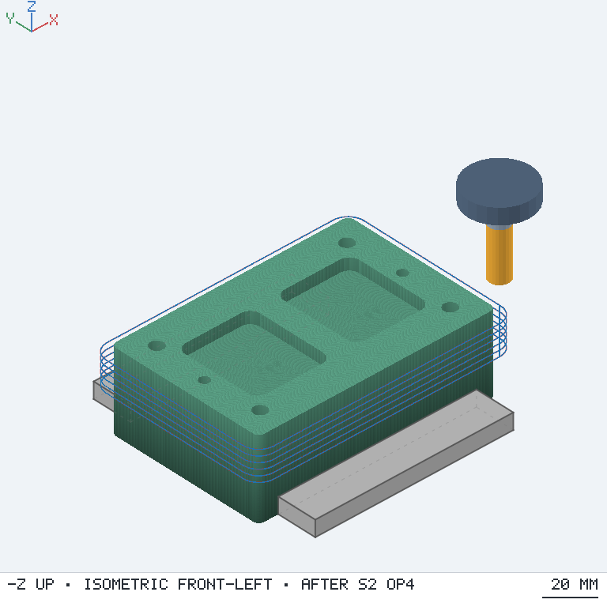

# MCP M1, Step 10: an agent plans a whole job, end to end (LIO-470)

`tests/mcp_e2e.rs` starts the real `axis-cam --mcp` on a pipe, with a fresh
data folder (`AXIS_CAM_DATA_DIR` in a temporary directory), and plans with
MCP tool calls only, the way Claude Code or Codex would. A fresh data folder
holds only the app's starter library (materials and holders, no machine and
no tools), so the agent makes the machine and the cutters itself.

```
cargo test --test mcp_e2e                       # the four tests
MCP_E2E_PICTURE=docs/verification/mcp-m1-e2e.png \
  cargo test --test mcp_e2e an_agent_plans -- --nocapture   # and the picture
```

Under `cargo test`, which builds the core (`axis-core`) at `opt-level` 1 and
the app at 0 (LIO-729), the four tests take about 4 minutes; with all of it
at `opt-level` 0 they took about 8 (the STEP
test, the longest, up to 12 when the machine is busy): every
command waits until the app's background work has settled, and after each
edit the app checks the left stock, the holding and the run again on the
whole job.

## The STEP job: `an_agent_plans_the_step_fixture_end_to_end`

**Part:** `examples/four-setup-block.step`, 120 × 80 × 40 mm. Its top
has a 12 mm deep pocket around a Ø18 boss with a Ø6 × 8 hole, and four Ø6.6
through holes with Ø11 × 6 counterbores. Its bottom has two 6 mm deep
pockets and two Ø5 × 8 holes. Its sides have features for setups 3 and 4,
which this job leaves for later (`check_job` lists them as still covered).

**Machine:** the user's Jingyan CNC4030, made in the wizard (`new_machine`,
`edit_field` target machine, `save_machine`): travel 305 × 405 × 100 mm
(measured), 24000 rpm, 800 W, 1000 mm/min, 160 mm from the spindle nose to
the table, gantry 120 × 390 mm. Its UC100 profile is the user's to choose
(an agent's save with controller UC100 is refused for want of it), so it
posts LinuxCNC programs.

**Material:** Aluminium 5052-H32, the user's project material.

**Stock:** a relative box, 3 mm round the part, 2 mm on top and 3 mm under
it: 126 × 86 × 45 mm. The 3 mm under it leave room for the drill's point
past the through holes' exit.

**Holding:** the starter library's 100 mm vise, on ±Y, grip 8 mm, placed by
`suggest_layout` for each setup.

**Tools** (made with `new_tool`, `edit_field` target tool, `save_tool`):

| T | Tool | Ø | Flutes | Flute length | Stick-out |
|---|---|---|---|---|---|
| 1 | Flat end mill 10mm | 10 | 3 | 25 | 35 |
| 2 | Flat end mill 3mm | 3 | 3 | 12 | 20 |
| 3 | Drill 6.6mm | 6.6 | 2 | 48 | 52 |

**Setup 1, top up (G54):**

| # | Operation | Tool | Picks (from) | Fields set | Minutes |
|---|---|---|---|---|---|
| 1 | Face | T1 | top face 60 (`part_report` top plane) | boundary Stock silhouette, containment Tool outside boundary; speeds recommended (6000 rpm, 770 mm/min) | 4.2 |
| 2 | Pocket | T1 | floor 854 (the 12 mm floor) | stepdown 1.5, allowance 0, axial allowance 0; speeds recommended | 14.3 |
| 3 | Counterbores and Ø6 hole | T2 | floors 846, 847, 850, 853 (6 mm) and 1119 (8 mm) | stepdown 1, allowances 0; speeds recommended (18370 rpm, 780 mm/min) | 3.8 |
| 4 | Contour · outside | T1 | none (the whole outline) | bottom offset 18, stepdown 3, allowance 0; speeds recommended | 5.5 |
| 5 | Drill Ø6.6 · 4 holes | T3 | one wall of each through hole (from `list_surfaces`, by the report's hole centres) | 6000 rpm, 480 mm/min, Deep drilling (3 mm pecks), through Yes, breakthrough 2.5, clearance 10 | 1.1 |

**Setup 2, turned over about X (`flip_setup rx`, G55):**

| # | Operation | Tool | Picks (from) | Fields set | Minutes |
|---|---|---|---|---|---|
| 1 | Face | T1 | bottom face 48 (`list_surfaces` planes, -Z up) | boundary Stock silhouette, containment Tool outside boundary (3 mm in two levels) | 8.4 |
| 2 | Pocket | T1 | floors 849, 851 (the two 6 mm pockets) | stepdown 1.5, allowances 0 | 6.7 |
| 3 | Ø5 holes | T2 | floors 848, 852 (the two Ø5 × 8 holes) | stepdown 1, allowances 0 | 3.2 |
| 4 | Contour · outside | T1 | none | bottom offset 16 (overlaps setup 1's by 6 mm), stepdown 3, allowance 0 | 3.7 |

**Why these numbers.** The outside contour cannot go down the whole 45 mm
from one side: the cut depth must stay under the 35 mm stick-out and above
the jaws. Setup 1 cuts to 18 mm above the part's bottom (24 mm deep), and
setup 2 cuts to 16 mm above the old top (27 mm deep), so the two meet with
6 mm of overlap. Setup 2 rests on what was setup 1's top, so the Face takes
the whole stock top (Stock silhouette), not just the part's outline: with
the part's outline only, a 3 mm rim stayed at the old height and
`check_job` said setup 2 could not rest in the vise. The drill is short
enough to fit under the spindle over the vise (with 65 mm of stick-out
`check_job` refused it: 174 mm needed, 160 mm there). It pecks to 2.5 mm
past the part's bottom: with the default 1 mm the 2 mm point leaves a cone
at the exit, and with only 2 mm of stock under the part a 2.5 mm
breakthrough went 0.5 mm into the vise, which `check_job` refused.

**Commands used**, in order: `import_model`; `new_machine`, `edit_field`
(machine) × 14, `save_machine`; `inspect {what: "libraries"}`; `add_setup
{machine}`; `set_project_material`; per tool `new_tool`, `edit_field` (tool),
`save_tool`; `edit_field` (setup) × 7; `list_fields`; `part_report`;
`list_surfaces`; per operation `add_operation`, `set_operation_tool`,
`pick_surfaces` (replace), `recommend_speeds`, `edit_field` (operation);
`add_setup`, `flip_setup`, `edit_field` (setup); `suggest_layout` × 2;
`generate_all`; `check_job`; `check_holding`; `view_model`; `export_gcode`;
`save_project`; `checkpoint`; then `open_project` in a fresh session, and
`--session <id>`, `inspect`, `list_checkpoints`, `execute` with
`if_revision` after the resume. Long steps answer `still_running` and the
test calls `wait`, as an agent does.

**`check_job`:** passed, no problems, 9 operations, 50.9 minutes in all.
The stock before setup 2 is 126 × 86 × 43 mm, the 2 mm faced off setup 1's
top missing at its bottom. Coverage: only the side faces of setups 3 and 4
are still covered (the +X slot and holes, the −Y bore and holes), and part
of the 0.6 mm edge breaks. `check_holding` for setup 2: holds.

**Exported programs:** `export_gcode` into a temporary folder wrote

- `four-setup-block - 1 Setup 1 (G54).ngc`, 11707 lines
- `four-setup-block - 2 Setup 2 (G55).ngc`, 6913 lines

`axis-cam --export-gcode <saved project> <folder>` writes the same two
files, line for line the same (the programs carry no time stamp).

**Saved, opened, resumed.** `save_project` wrote the project; a new server
in a new session opened it with `open_project`: the same setups, operations,
tools and every operation's fields as `list_fields` gives them. The first
session's client was then ended (stdin closed) and a new server started with
`--session <id>`: the same job, the same revision, no change reported as the
user's, the project file and its saved state, the export and the save in
`last_saves_and_exports`, and the checkpoint. An `execute` with the
`if_revision` the agent last saw went through.

## The picture: `mcp-m1-e2e.png`

`view_model {operation: setup 2's Contour, labels: false}`: setup 2, −Z up,
isometric from the front left, the stock after the last operation.



What it shows, read as a machinist: the part upside down in the vise, the
jaws on ±Y gripping the bottom 8 mm (setup 1's top). The bottom is faced
flat, the two 6 mm pockets are open with the rib between them, the two Ø5
holes are cut at the X ends, and the four Ø6.6 through holes come out on the
bottom face. The outside contour's passes (blue) go round the part and stop
well above the jaws; the walls are continuous where setup 1's contour and
setup 2's meet, with no step or rim.
The 10 mm end mill and its holder stand clear above. Sections through the
holes (not saved) show each Ø6.6 hole running the whole 40 mm with its Ø11
counterbore at the old top, and from above after setup 1 the pocket round
the Ø18 boss with its Ø6 hole and the four counterbores.

## Manual mill and lathe, with commands only

`an_agent_builds_a_manual_mill_setup_with_commands_only`, on
`examples/four-setup-block.3mf`: a Manual Mill made in the wizard (90–1600
rpm, 5 mm edge finder); a Ø12 end mill, a Ø6.6 HSS drill and an A2.5 × 6.3
centre drill, each ticked for it with `tool_machine`; the vise ticked for it
with `edit_holder`, `holder_machine`, `save_holder`; `add_manual_setup` with
the same stock and the vise. A Box filled by one click on the top face
(`pick_surfaces` replace: Z 0 to −2), its speed recommended (the mill's
1600 rpm); a Drill on the four through holes, which brings its centre
drilling (a second `add_centring` is refused). `suggest_layout`,
`generate_all`, `check_job` passes. `inspect {what: "steps"}` reads every
step, the Holes step of the drill with its four holes, and the machinist's
place, the selection and the revision stay as they were.

`an_agent_builds_a_lathe_setup_with_commands_only`: a stepped shaft (Ø30 ×
30 mm and a Ø16 × 20 mm pin) that the test writes as an OBJ; a Lathe made in
the wizard and a turning tool; `add_lathe_setup` (a round bar in the 3-jaw
chuck); an Outside filled by a click on the pin (Ø16 to Z −21), depth 1 mm a
pass; a Face filled by a click on the free end, moved first with
`move_operation`; `suggest_layout` (the chuck already chosen: no_change);
`generate_all`; `check_job` passes; its steps read without moving the place.

`a_session_resumed_untouched_reports_no_change`: a session only looked at is
resumed twice with nothing reported as the user's change and the same
library ids.

## Bugs found and fixed

- **The first call of a session closed at once** (`src/mcp/engine.rs`,
  `Agent::poll`). A call held until the session had started was started in
  the same poll that had already read "settled", so its window closed before
  its work began: `import_model` as the first call answered `failed` in
  90 ms with the model still loading.
- **A session never edited kept no workspace** (`src/mcp/runner.rs`,
  `Host::new`). Until an edit, nothing wrote `workspace.json`, so each start
  made the starter library afresh with new ids, and a resume reported about
  sixty materials and holders removed and added as the user's change.
- **`inspect {what: "libraries"}` did not exist** (`src/mcp/engine.rs`).
  The spec has it and the library commands' refusals point to it, but
  `inspect` ignored `what` and answered the whole state: an agent had no way
  to learn a machine's, material's or holder's id. It now lists the
  machines, tools, materials and holders with their ids and fields, and an
  unknown `what` is an error.
- **`move_operation` and `move_setup` with |delta| > 1 swapped**
  (`src/mcp/commands.rs`). The app swaps an item with the one `delta` away
  (its buttons send ±1), so a move of two places jumped the item in between
  too, and the effect check, which only looked at the moved item, said done.
  They now send one click a place, and a move out of the list is refused.
- **`suggest_layout` answered `failed` when it succeeded**
  (`src/mcp/commands.rs`). When the layout it suggests is the one saved
  already, the setup does not change and the status says "Suggested: …";
  that read as a failure. It is now `no_change`, in the app's words.
- **`add_centring` ran on any operation** (`src/mcp/commands.rs`). It made
  "Centre drill · Contour · outside" on a CNC contour. It is now offered as
  the app offers it: on a manual-mill twist drill not yet centred.

Found outside `src/mcp`, not changed: a centring added with a manual-mill
Drill, before the drill has holes, is named "Centre drill · " (empty), since
`centre::centring` (`crates/axis-core/src/centre.rs`) names it after the drill's stored name,
which is still empty then.
